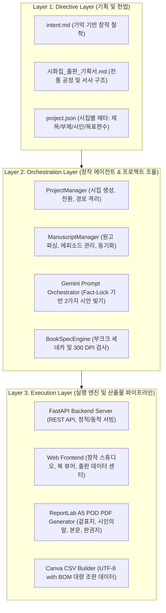
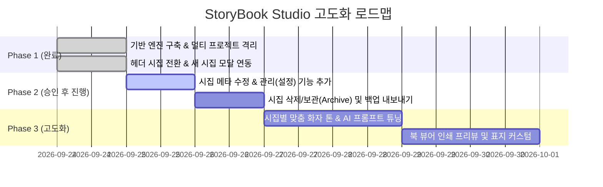

# [개발 계획서] StoryBook Studio: 멀티 시집(다권/다인) 출판 플랫폼 고도화

> **기준 참조**: 인접 프로젝트 `TogetherStory`(시니어 자서전 에이전틱 AI)의 **3-Layer Architecture (Directive - Orchestration - Execution)** 및 `BookReader`의 **기능 명세화·단계별 검증 표준**을 준용합니다.

---

## 1. 프로젝트 개요 및 기획 의도 (Overview & Intent)

### 1.1. 배경 및 목적
- **기존 한계**: 단일 시화집(「기억이 머무는 자리 - 어머니의 무명베」) 단편 집필에 국한되어 다권 집필이나 다양한 시인(저자)의 작품집을 독립적으로 제작·관리할 수 없는 구조적 한계 존재.
- **확장 목표**: 누구나 자신의 실제 생애 기억을 바탕으로 독자적인 시집을 개설하고, 각각의 원고·삽화·출판용 PDF·Canva 대량 조판 CSV를 독립적으로 관리·출판할 수 있는 **"다권(Multi-Book) 및 다인(Multi-Author) 시화집 독립출판 웹 스튜디오"**로 플랫폼화.

### 1.2. 인접 프로젝트 참조 및 준용 기준
1. **TogetherStory (`d:/AG/TogetherStory`) 참조 기준**:
   - **3-Layer Architecture**: 기획 원칙(Directive) ➔ 창작 조율(Orchestration) ➔ 엔진 실행(Execution)의 엄격한 계층 분리.
   - **Fact-Lock (사실 잠금 원칙)**: AI의 허구 날조(Hallucination)를 원천 차단하고 구술 기억의 사실과 입말만을 시의 원료로 활용.
   - **출판 가치 환원 (End-to-End POD)**: 디지털 저작에서 멈추지 않고 부크크(Bookk) POD 인쇄 규격의 실물 책 출판으로 완결.
2. **BookReader (`d:/AG/BookReader`) 참조 기준**:
   - **모듈별 기능 명세화 (Feature Breakdown)**: 화면 UI와 백엔드 로직 간의 명확한 데이터 모델(Schema) 바인딩.
   - **단계별 마일스톤 (Phased Implementation)**: 사전 계획 승인 후 점진적 구현 및 단계별 검증.

---

## 2. 시스템 아키텍처 (System Architecture)



---

## 3. 멀티 프로젝트 데이터 격리 구조 (Data Isolation Architecture)

각 시집은 물리적으로 격리된 디렉토리에서 독자적인 데이터 라이프사이클을 갖습니다.

```
d:/AG/StoryBook/
├── .active_project                 # 현재 작업 중인 시집 ID (예: mother_cotton)
├── projects/                       # 멀티 시집 프로젝트 루트
│   ├── mother_cotton/              # 1호 시집 (어머니의 무명베 회상기)
│   │   ├── project.json            # 메타데이터 (제목, 부제, 시인, 목표편수, 설명)
│   │   ├── 작품집_원고.md          # 1호 시집 전용 원고 (현재 9편 수록)
│   │   ├── 시화집_본문데이터.csv    # 1호 시집 Canva 대량 조판용 CSV
│   │   ├── 시화집_완성본.pdf       # 1호 시집 부크크 A5 완제 전자책/인쇄용 PDF
│   │   └── images/                 # 1호 시집 전용 300 DPI 삽화 보관소
│   │
│   ├── {project_id}/               # 신규 추가 시집 (예: sunset_memories)
│   │   ├── project.json
│   │   ├── 작품집_원고.md
│   │   ├── 시화집_본문데이터.csv
│   │   ├── 시화집_완성본.pdf
│   │   └── images/
│   │
├── web/                            # 프론트엔드/백엔드 웹 스튜디오 UI
└── core/                           # 핵심 엔진 (project_manager, pdf_builder, csv_builder 등)
```

---

## 4. 모듈별 세부 기능 명세 (Feature Breakdown)

### 4.1. 시집 프로젝트 관리 (Project Management)
- **시집 선택 (Switch Project)**:
  - 상단 헤더의 드롭다운에서 선택 즉시 현재 작업 공간 전환.
  - 전환 시 원고 진행 상태, 북 뷰어, 출판 다운로드, 이미지 검사기가 활성 시집 데이터로 동적 리로드.
- **새 시집 생성 (Create Project)**:
  - 모달 폼: 시집 제목, 부제, 시인명, 목표 편수(기본 35편), 기획 의도.
  - 고유 ID 폴더 생성 및 템플릿 마크다운 원고/CSV 초기화.
- **시집 정보 수정 및 관리 (Project Settings)**:
  - 시집 제목, 부제, 시인명, 기획 의도 등 메타데이터 실시간 수정 지원.

### 4.2. 사실 잠금 시화 창작 스튜디오 (Fact-Lock Studio)
- **기억 인터뷰 인터페이스**:
  1. 기억의 중심 (시간, 장소, 사람)
  2. 감각적 디테일 (사물, 행동, 촉각/청각)
  3. 실제 한 말 / 들었던 말 (입말 보존)
- **Gemini AI 창작 동반자**:
  - 활성 시집의 테마와 기획 의도를 주입하여 2가지 대안 시안(A안: 담담한 묘사 / B안: 여운과 은유) 동시 산출.
  - Fact-Lock 카드에 입력 사실을 요약 표시하여 허구 개입 방지.
- **원고 저장 및 자동 반영**:
  - 최종 선택 및 다듬은 본문을 저장 시 해당 시집의 `작품집_원고.md`와 `시화집_본문데이터.csv`에 즉시 동기화.

### 4.3. 가상 시화집 북 뷰어 (Virtual Book Viewer)
- **A5 2페이지 스프레드 조판**:
  - 좌측: 300 DPI 수채화 삽화 (재단선 및 제본 여백 보호).
  - 우측: 시 본문 (행 수에 따른 폰트/행간 동적 스케일링으로 인쇄 영역 이탈 방지).
- **시집별 작품 네비게이션**: 이전/다음 버튼 및 작품 바로가기 셀렉터.

### 4.4. 원클릭 출판 데이터 센터 (Publishing Pipeline)
- **부크크(Bookk) POD 완제 PDF 다운로드**:
  - 현재 시집의 제목, 부제, 시인명이 표지 및 판권지에 정확히 인쇄되는 A5 규격 PDF 즉시 빌드 및 다운로드.
- **Canva 대량 조판용 CSV 다운로드**:
  - Canva [앱 > 대량 제작]에 바로 연결 가능한 UTF-8 with BOM 인코딩 CSV 제공.
- **인쇄 규격 및 책등(세네카) 계산기**:
  - 페이지 수 및 용지별 책등 두께와 표지 캔버스 규격 산출.

---

## 5. 단계별 구현 로드맵 (Phased Roadmap)



### [Phase 1: 기반 완료] 멀티 프로젝트 엔진 및 데이터 격리
- `ProjectManager` 모듈 구현 및 `.active_project` 기반 라우팅.
- 상단 헤더 프로젝트 전환기 및 새 시집 개설 모달 완비.
- 시집별 원고, CSV, PDF, 삽화 디렉토리 격리 및 완벽 동기화.

### [Phase 2: 승인 후 착수] 프로젝트 관리 편의성 극대화 (Project Management Suite)
1. **시집 정보 수정(설정) 모달 추가**:
   - 이미 생성된 시집의 제목, 부제, 시인명, 목표 편수를 웹에서 즉시 수정 가능하도록 API 및 UI 제공.
2. **시집 관리 대시보드 / 보관함(Archive) 기능**:
   - 작업 완료된 시집을 보관(Archive)하거나 잘못 만든 시집을 안전하게 삭제/정리하는 기능.
   - 시집 단위 전체 백업(ZIP 다운로드) 기능 지원.

### [Phase 3: 창작 경험 고도화] 시집별 맞춤형 시안 엔진
1. **시집 기획 맞춤 프롬프트 주입**:
   - 시집마다 설정된 기획 의도(예: 유년의 추억, 부모님에 대한 헌사, 계절과 일상)에 따라 Gemini 프롬프트 톤을 최적화.
2. **삽화 일관성 스타일러**:
   - 시집별로 일관된 화풍(예: 한국적 서정 수채화, 흑백 목판화풍, 맑은 수묵담채 등)을 지정하고 프롬프트에 자동 반영.

### [Phase 4: 출판 완성도 강화] POD 표지 및 조판 커스텀
1. **표지 스타일 템플릿 선택**: 미니멀 크림, 앤틱 레더, 서정 일러스트 등 표지 레이아웃 프리셋.
2. **부크크 표지 펼침면 파일 원클릭 자동 생성**: 본문 내지뿐 아니라 앞표지+책등+뒤표지가 결합된 단일 표지 인쇄 파일 자동 생성.

---

## 6. 검증 및 인수 기준 (Acceptance Criteria)

1. **데이터 무결성 검증**:
   - 시집 A에서 작성한 시가 시집 B에 절대 노출되거나 덮어써지지 않아야 함.
   - 시집 전환 시 헤더 배지, 원고 목록, 북 뷰어, CSV, PDF 다운로드 파일명이 일치해야 함.
2. **출판 규격 적합성**:
   - 부크크 A5(148×210mm) 인쇄 시 제본선(안쪽 46pt)과 바깥 여백(36pt)이 침범되지 않아야 함.
   - 장문 시의 경우 자동 스케일링으로 인쇄 페이지를 벗어나지 않아야 함.
   - Canva CSV 파일은 엑셀 및 Canva에서 한글 깨짐 없이 필드가 자동 매핑되어야 함.
3. **사용자 승인 절차 준수**:
   - 본 계획서에 대한 사용자의 검토 및 승인 확인 후 다음 단계 코딩 작업을 착수함.
