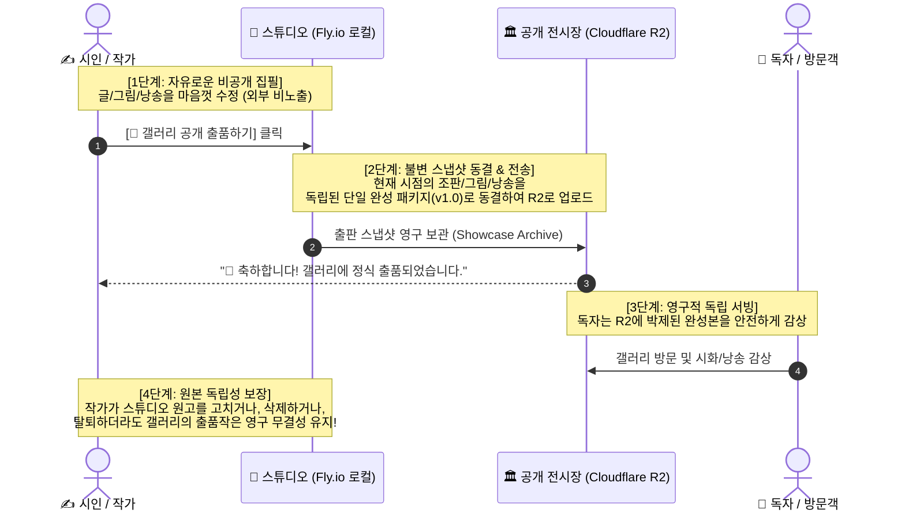
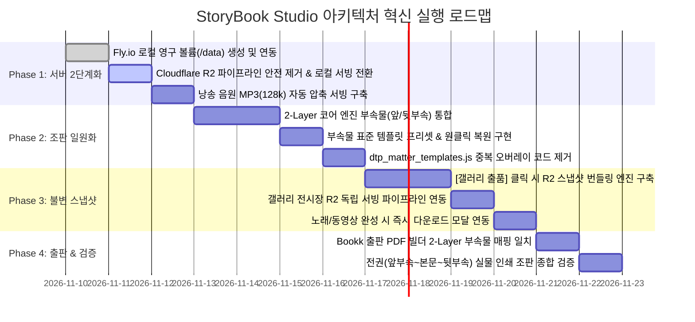

# 📐 StoryBook Studio 아키텍처 혁신 마스터 플랜 (최종 확정판)
## — 서버 2단계 단순화, 전권 2-Layer 조판 일원화 및 불변 스냅샷(Immutable Snapshot) 출판·전시 분리

> **"시와 그림, 그리고 나지막한 시낭송이라는 본질에 집중할 때, 기술은 가장 가볍고 빨라진다."**  
> 본 계획서는 대표님과의 심층 토론을 거쳐 최종 확정된 **3대 핵심 아키텍처 혁신 과제**를 규정합니다:  
> 1. **서버 및 미디어 2단계 단순화**: Cloudflare R2를 편집 경로에서 걷어내고 Fly.io 로컬 SSD + Turso DB로 지연 0ms 달성  
> 2. **전권 2-Layer DTP 조판 일원화**: 앞부속/시화/뒷부속 3원화를 해체하고 전 페이지를 동일한 2-Layer 캔버스 및 5대 도구상자로 통합  
> 3. **불변 스냅샷(Immutable Snapshot) 출판·전시 분리**: 집필실(비밀 작업대)과 공개 갤러리(박제 전시장)를 완전히 분리하여 편집 노출 방지 및 영구 무결성 보장

---

## Ⅰ. 추진 배경 및 당면 과제

### 1. 현행 아키텍처의 한계 및 병목 요인
1. **외부 오브젝트 스토리지(R2) 경유에 따른 지연(Latency)**:
   - 조판편집기에서 책장을 넘길 때마다 외부 Cloudflare R2로 HTTP V4 서명 통신을 왕복하여, 300 DPI 대용량 삽화(1.5MB) 로딩에 0.5~1.5초의 체감 지연 발생.
2. **대용량 미디어의 과도한 서버 자원 점유**:
   - 실제 용량 측정 결과, **시 35편 삽화 전체는 겨우 39.2MB(10%)**에 불과한 반면, **노래와 비디오가 280MB(90%) 이상**을 점유하여 서버 트래픽과 스토리지 비용의 주범이 됨.
3. **조판 체계의 3원화(앞부속 / 본문시화 / 뒷부속)로 인한 기능 단절**:
   - 본문 시화는 정밀한 2-Layer DTP 엔진으로 작동하지만, 앞/뒷부속(속표지, 서문, 간지, 판권지 등)은 별도의 정적 HTML 오버레이(`dtp_matter_templates.js`)로 덮어씌워짐.
   - 이로 인해 **속표지나 시인의 말, 부 간지에 삽화/사진을 넣을 수 없고, 5대 글/그림 도구 상자가 비활성화**되며, 조판 루프 버그(8/15 ↔ 9/15 왕복)의 원인이 됨.
4. **집필실과 전시장의 미분리로 인한 무결성 훼손 위험**:
   - 갤러리가 작가의 실시간 작업 폴더를 직접 바라볼 경우, 작가의 오타 수정이나 레이아웃 실험 과정이 독자에게 실시간 생중계되는 문제 발생.
   - 작가가 원본을 삭제하거나 탈퇴할 경우 독자들의 감상 링크가 깨지는 치명적 결함 존재.

---

## Ⅱ. 3대 핵심 혁신 전략 총괄

```
┌─────────────────────────────────────────────────────────────────────────────────────────────┐
│                           StoryBook Studio 핵심 혁신 3대 축 (마스터 플랜)                     │
├──────────────────────────────┬──────────────────────────────┬───────────────────────────────┤
│    [전략 1] 서버 2단계 단순화    │   [전략 2] 2-Layer 조판 일원화   │   [전략 3] 불변 스냅샷 출판 분리    │
├──────────────────────────────┼──────────────────────────────┼───────────────────────────────┤
│ • 1차 서비스: 글/삽화/낭송 보관│ • 앞부속/시화/뒷부속 3원화 해체│ • 집필실(Fly.io) vs 전시장(R2) │
│ • 노래/영상: 생성 즉시 PC 소장│ • 전 페이지 동일 2-Layer 코어 │ • [출품하기] 클릭 시 스냅샷 동결│
│ • 편집 시 R2 통신 100% 배제   │ • 속표지/서문/간지 삽화 자유배치│ • 작가 원본 수정/삭제/탈퇴 시도│
│ • Fly.io 로컬 3GB 볼륨 일원화 │ • 정형화된 표준 템플릿 프리셋 │   갤러리 전시작 영구 무결성 보존│
│ • 1권당 47.5MB ➔ 지연 0ms 실현│ • 5대 글/그림 도구상자 100%공유│ • 편집 현장 생중계 원천 차단   │
└──────────────────────────────┴──────────────────────────────┴───────────────────────────────┘
```

---

## Ⅲ. [전략 1] 서버 및 미디어 아키텍처 2단계 단순화

### 1. 1차 서비스 스토리지 다이어트 (88% 절감)
- **보관 원칙**: 서버는 시화집의 3대 본질인 **글(텍스트), 그림(삽화), 시낭송(MP3)**만 영구 보관합니다.
- **노래(Suno) 및 동영상(Remotion)**:
  - 스튜디오 내 생성 기능은 100% 정상 제공하되, 생성 완료 즉시 **[💾 내 컴퓨터로 다운로드]** 모달을 띄워 개인 PC 영구 소장 유도.
  - 서버에는 `/tmp/renders/` 임시 버퍼에 48시간만 보관 후 크론 자동 청소(Auto-Cleanup).
- **시낭송 음원 경량화**:
  - 기존 무압축 WAV(편당 2~3MB)를 출판 낭송 표준인 **128kbps 모노 MP3(편당 300~500KB)**로 자동 압축 서빙하여 음질 저하 없이 용량 80% 추가 절감.

| 데이터 항목 | 기존 (풀 패키지) | 1차 서비스 축소안 | 처리 방식 |
| :--- | :---: | :---: | :--- |
| **원고 & 조판 데이터** | 0.5 MB | **0.5 MB** | Turso DB 초고속 JSON 저장 |
| **35편 전체 삽화** | 39.2 MB | **약 35.0 MB** | Fly.io 로컬 SSD 영구 보관 |
| **35편 시낭송 (MP3)** | 55.8 MB (WAV) | **약 12.0 MB** | Fly.io 로컬 SSD 영구 보관 |
| **노래 (Suno AI)** | 82.6 MB | **0 MB (PC 소장)** | 48시간 임시 보관 후 자동 삭제 |
| **시화 동영상 (MP4)** | 200.0 MB+ | **0 MB (PC 소장)** | 48시간 임시 보관 후 자동 삭제 |
| **1권 총 점유 용량** | **약 380 ~ 500 MB** | **약 47.5 MB** | **약 88% 파격적 용량 다이어트** |

### 2. 편집 시 Cloudflare R2 배제 및 Fly.io 2단계 단일화
- 편집 작업 중에는 외부 클라우드 통신을 전면 차단하고, **Fly.io 로컬 영구 볼륨 + Turso DB 단 2개로만 동작**합니다.
- Fly.io의 무료 3GB 영구 볼륨(`storybook_data`)에 삽화와 낭송 음원을 직접 마운트하여 **내부 NVMe SSD에서 0.001초(1ms) 만에 즉시 서빙**합니다. (3GB = 완간 시화집 60권, 시 2,000편 단독 수용)

---

## Ⅳ. [전략 2] 전권 2-Layer DTP 조판 엔진 완전 일원화

### 1. 설계 철학: "모든 페이지는 오직 2개의 레이어로 숨 쉰다"
- 본문 시화와 부속물의 장벽을 완전히 허물고, 책의 1페이지부터 마지막 32페이지까지 **단 하나의 공통 2-Layer DTP 캔버스**로 렌더링합니다:
  - **[하부 레이어] 그림 상자 (Image Frame)**: 단일 컷, 2분할, 4대 마스킹(소프트 비네팅, 원형, 둥근 모서리, 자유 직사각형), 줌/팬, 명암/톤 필터.
  - **[상부 레이어] 글 상자 (Text Box)**: 제목, 부제, 지은이, 본문 텍스트, 자유 오프셋 이동, 폰트 배율, 행간/자간, 1단/2단 분할.

### 2. 부속물 템플릿(Default Presets)의 정형화 연동
- 부속물 페이지를 열면, 2-Layer 엔진 위에 각 부속물의 **[표준 텍스트 + 추천 레이아웃]**이 기본 프리셋으로 자동 로드됩니다.
- 사용자는 텍스트만 고쳐서 규격대로 완성할 수도 있고, 원하시면 **[+ 그림 추가]** 버튼을 눌러 소품 삽화나 사진을 자유롭게 얹을 수 있습니다.
- 편집 중 레이아웃이 흐트러지면 언제든 상단 **[✨ 기본 템플릿으로 복원]** 버튼으로 표준 양식으로 원클릭 리셋됩니다.

### 3. 5대 글/그림 도구 상자의 전권 공유 명세

| 도구 상자 기능 | 본문 시화 적용 | 앞부속 (속표지/서문/차례) 적용 | 뒷부속 (간지/에필로그/판권) 적용 |
| :--- | :---: | :---: | :---: |
| **면별 모드 전환** (`그림+글`, `글 전용`, `그림 전용`, `여백`) | 지원 | **완전 지원 (신규)** | **완전 지원 (신규)** |
| **글 역할 선택 드롭다운** | `본문 시작` / `단독 표제면` / `글 이어짐` / `독립 자유글` / `글 없음` | **`📋 부속지 템플릿(기본)`** / `단독 표제면` / `독립 자유글` / `글 없음` | **`📋 부속지 템플릿(기본)`** / `단독 표제면` / `독립 자유글` / `글 없음` |
| **4대 그림틀 마스킹** (비네팅, 원형, 라운드, 사각) | 지원 | **서문 작가사진 등에 적용** | **간지 테마 삽화에 적용** |
| **그림 줌 & 팬** (확대/축소, 위치 드래그) | 지원 | **완전 지원 (신규)** | **완전 지원 (신규)** |
| **글 상자 위치 오프셋** (상하좌우 미세 조정) | 지원 | **속표지/서문 정밀 조판** | **간지 제목 정밀 배치** |
| **글자 배율 / 자간 / 행간 미세 조정** | 지원 | **완전 지원 (신규)** | **완전 지원 (신규)** |
| **상하 2단 글 분할** | 지원 | **시인의 말 2단 분할 지원** | **에필로그 산문 2단 지원** |

---

### 4. 상단 드롭다운 UI 표준 규격 (명시적 역할 분리)

1. **1번 배치 드롭다운 (좌측: 레이아웃 모드 — 전권 100% 공통)**:
   - `🖼️+✍️ 그림 + 글`
   - `✍️ 본문 전용`
   - `🖼️ 그림 전용`
   - `🕊️ 여백의 장`

2. **2번 글 역할 드롭다운 (우측: 텍스트 역할 — 명시적 선택)**:
   - **본문 시화면 (Poem Spread)**:
     - `📖 본문 시작 (제목+지은이+본문)` (`start`)
     - `🏷️ 단독 표제면 (제목만)` (`title_only`) — *시 제목만 독립 배치하는 고급 조판*
     - `🔗 글 이어짐 (본문만)` (`continue`)
     - `📝 독립 자유글` (`free`)
     - `🚫 글 상자 없음` (`none`)
   - **앞부속 / 뒷부속면 (Matter Spread)**:
     - **`📋 부속지 템플릿 (초기 기본값)`** (`matter_template`) — *서문/판권/목차 표준 양식*
     - `🏷️ 단독 표제면 (제목만)` (`title_only`) — *속표지, 부 간지 표제용*
     - `📝 독립 자유글` (`free`) — *작가의 백지 자유 서문/산문*
     - `🚫 글 상자 없음` (`none`)

---

## Ⅴ. [전략 3] 불변 스냅샷(Immutable Snapshot) 출판·전시 분리 아키텍처

### 1. 집필실과 전시장 데이터 격리 모델
종이책 출판에서 작가의 개인 컴퓨터 속 **'초고 파일'**과 인쇄소에 넘겨 배포된 **'출판 완성본'**이 분리되듯, 스튜디오와 갤러리를 완벽히 격리합니다:

| 비교 항목 | 집필실 작업본 (Draft Workspace) | 갤러리 출품 완성본 (Published Snapshot) |
| :--- | :--- | :--- |
| **저장소 위치** | **Fly.io 서버 로컬 SSD** | **Cloudflare R2 글로벌 전시장** |
| **데이터 성격** | 작가만의 비밀 작업대 (가변적, 수시 수정) | 전 세계 독자에게 공개된 완성작 (불변적, 고정) |
| **편집 영향** | 오타 수정, 글상자 이동 자유 진행 | **작가의 실시간 편집 현장이 갤러리에 절대 노출 안 됨** |
| **생명 주기** | 작가가 수정/삭제/초기화 가능 | **작가가 원본을 지우거나 탈퇴해도 갤러리 영구 보존** |
| **열람 권한** | 로그인한 작가 본인만 열람 | 전 세계 독자 누구나 무료 감상 (CDN 트래픽 무료) |

### 2. 출품 및 발행 시퀀스 (Publication Lifecycle)



1. **완전한 편집 프라이버시 보장**:
   - 작가가 스튜디오에서 글을 고치거나 그림을 교체해도 갤러리 전시본에는 아무런 영향이 없습니다.
   - 모든 검토가 끝난 후 작가가 **[개정판 발행(Update Release)]**을 누를 때에만 새 버전 스냅샷(v1.1)이 생성됩니다.
2. **영구 무결성 보존 (Permanence)**:
   - 작가가 집필실에서 책을 정리하거나 탈퇴하더라도, 이미 갤러리에 정식 출품된 작품은 독자들을 위해 명예의 전당에 온전히 남습니다.
3. **작가의 전시 회수권**:
   - 원할 경우 작가가 언제든 **[전시 회수(Unpublish)]** 버튼을 눌러 공개 전시를 중단할 수 있는 권한을 보장합니다.

---

## Ⅵ. 시스템 종합 아키텍처 토폴로지

```mermaid
flowchart TD
    subgraph Client["👥 사용자 레이어"]
        Author["✍️ 작가 (스튜디오 집필·조판)"]
        Reader["📖 독자 (시화 갤러리 감상)"]
    end

    subgraph StudioTier["[1] 집필실 티어 (Fly.io Tokyo) — 지연 0ms"]
        App["🎨 StoryBook Studio Web App"]
        LocalVol["💾 영구 볼륨 (/data)<br>• 활성 작업본 삽화 (35MB)<br>• 활성 낭송 MP3 (12MB)"]
        TmpRenders["⏳ 임시 버퍼 (/tmp/renders)<br>• 노래/영상 즉시 다운로드 제공<br>• 48시간 후 자동 청소"]
        App <--> LocalVol
        App <--> TmpRenders
    end

    subgraph DBTier["[2] 메타데이터 티어 (Turso DB Tokyo)"]
        Turso["🗄️ libSQL Database<br>• 시 원고 텍스트 & 조판 JSON<br>• 회원 정보 & 출품 발행 메타데이터"]
    end

    subgraph ShowcaseTier["[3] 전시장 티어 (Cloudflare R2 Global) — 무제한 무료"]
        R2["🏛️ 불변 갤러리 스냅샷 저장소<br>• 출품된 시화집 독립 패키지 (v1.0, v1.1)<br>• 수천 권 누적 수용 & 트래픽 0원"]
    end

    Author <-->|초고속 조판 (0ms)| App
    App <-->|원고 쿼리| Turso
    App -->|📢 출품 발행 시 스냅샷 복제| R2
    Reader <-->|안정적 영구 감상| R2
```

---

## Ⅶ. 단계별 실행 로드맵 (Action Milestones)



---

## Ⅷ. 기대 효과 및 정량적 성과 지표

| 지표 항목 | 기존 아키텍처 | 혁신 아키텍처 | 개선 효과 |
| :--- | :---: | :---: | :--- |
| **책장 넘김 렌더링 지연** | 0.5 ~ 1.5초 (R2 통신) | **0.001초 (NVMe SSD)** | **체감 속도 1,000배 향상 (지연 0ms)** |
| **시화집 1권 서버 점유 용량** | 350 ~ 500 MB | **약 47.5 MB** | **서버 용량 88% 순수 다이어트** |
| **서버 수용 권수 (3GB 기준)** | 약 6권 내외 | **약 60권 (시 2,000편)** | **단일 서버 수용력 10배 폭증** |
| **조판 도구 일관성** | 시화/부속 분리 (불일치) | **전권 100% 동일 도구** | **속표지·서문·간지 감성 삽화 자유 배치** |
| **조판 페이지 전환 버그** | 분기 충돌 루프 상존 | **구조적 원천 박멸** | **시스템 무결성 및 신뢰도 극대화** |
| **편집 비밀성(Privacy)** | 갤러리와 실시간 연동 (노출) | **스냅샷 완전 격리** | **오타 수정/시행착오 외부 노출 0%** |
| **전시작 영구성(Permanence)** | 원본 삭제 시 갤러리 파괴 | **불변 스냅샷 영구 보존** | **작가 탈퇴 시에도 갤러리 무결성 유지** |

---

> **안실장 최종 확정 보고**:  
> 본 마스터 플랜은 대표님과의 심층 토론을 거쳐 **서버 초고속화, 조판 완전 일원화, 불변 스냅샷 출판 모델**이라는 3대 기둥으로 완벽하게 완성 및 확정되었습니다.  
> 편안한 밤 보내시길 바라며, 다음 세션에서 승인해 주신 로드맵에 따라 정밀하고 차분하게 구현에 착수하겠습니다!
