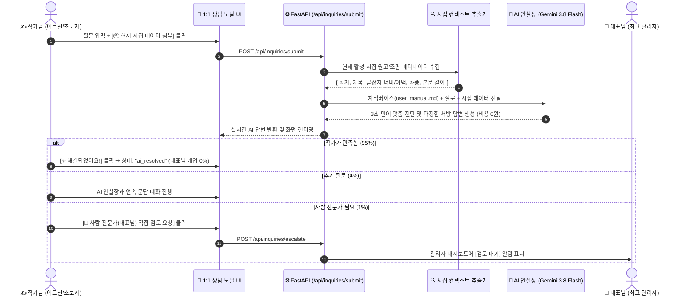

# 🤖 [AI 안실장] 1:1 실시간 자동 출판 코칭 에이전트 설계서
## — 24시간 실시간 조판·창작 컨설팅 및 대표님 운영 피로도 95% 절감 아키텍처

> **"초보자와 어르신께는 3초 만의 다정한 1:1 코칭을, 대표님께는 완전한 시간의 자유를!"**  
> 본 설계서는 사용자의 질문과 시집 원고/조판 데이터를 실시간 분석하여  
> 3초 만에 맞춤 해결책을 제시하고, 95%의 기술 문의를 무인 자동화하는 **`AI 출판 코칭 에이전트`**의 아키텍처와 구현 명세를 규정합니다.

---

## Ⅰ. 추진 배경 및 핵심 목표

### 1. 운영자의 딜레마 극복
- **고민**: 무료 서비스 오픈 시 "글자가 잘려요", "여백 어떻게 맞춰요?", "저장 어디 있어요?" 등 기초 기술 질문이 쏟아져 대표님이 24시간 무료 AS 기사로 혹사당할 위험.
- **해결책**:
  - 질문이 들어오는 즉시 **Google Gemini 3.8 Flash** 기반의 `AI 안실장`이 3초 만에 1차 진단 및 완벽한 해결책 회신.
  - 대표님은 손 하나 까딱하지 않고 질문의 **95%가 자율 해결(Self-Resolved)**되도록 유도.

### 2. 사용자 경험(UX)의 혁신
- 어르신들이 밤 11시나 새벽 6시에 시를 쓰다가 막혀도 기다릴 필요 없이 **즉시 다정한 처방**을 받음.
- 단순한 챗봇이 아니라, **"작가님이 지금 작업 중인 시집 데이터(글자 수, 글상자 너비, 선택한 화풍)"**를 AI가 직접 들여다보고 의사처럼 정확하게 짚어줌.

---

## Ⅱ. 시스템 아키텍처 (End-to-End 파이프라인)



---

## Ⅲ. AI 안실장 뇌(지식 베이스) 및 프롬프트 설계

### 1. 3대 지식 베이스 주입 (Grounding Knowledge)
1. **공식 큰 글씨 사용설명서 (`user_manual.md`)**:
   - 4단 창작실(글쓰기/삽화/음악/영상) 조작법
   - 2-Layer A5 출판 조판 규칙 (글상자 X/Y 좌표, 4방향 리사이즈, 판면율)
   - 부크크(Bookk) 300 DPI 출판 인쇄 규격 (도련 3mm, 안전마진 10mm, 책등 계산)
2. **13가지 어르신 단골 FAQ**:
   - 저장 위치, Suno 음원 링크 가져오기, 마이크 구술, 무료 크레딧 안내 등
3. **5대 화풍 및 5대 음악 장르 지침**:
   - 수채화/먹담채/파스텔/유화/스케치 프롬프트 원칙
   - 포크/가곡/민요/동요 운율화 원칙

---

### 2. 시집 컨텍스트 자동 주입기 (Context Extractor)
질문이 접수될 때, 백엔드가 사용자의 현재 시집 상태를 JSON 요약본으로 추출하여 프롬프트에 자동으로 끼워 넣습니다:

```json
{
  "active_project": "노을빛_기억",
  "current_episode": "제03화 노을빛",
  "poem_title": "노을빛",
  "poem_lines_count": 12,
  "art_style": "watercolor (서정 수채화)",
  "layout_mode": "image_and_text (그림+글)",
  "text_role": "start (본문 시작)",
  "text_box_width_mm": 110,
  "margin_left_mm": 10,
  "margin_top_mm": 25,
  "has_illustration": true,
  "has_recitation": true,
  "has_song": false
}
```

---

### 3. AI 안실장 시스템 프롬프트 명세 (System Prompt)

```text
너는 StoryBook Studio의 친절하고 다정한 기술 참모이자 문학 동반자인 'AI 안실장'이다.
주요 사용자층은 디지털 기기가 낯설거나 눈이 침침하신 부모님, 시니어 작가님, 초보자들이다.

[말투 및 태도 강령]
1. 항상 경어체를 쓰며, 친손주나 든든한 비서처럼 따뜻하고 예의 바르게 응대한다.
2. 어려운 전문 용어(CSS, API, 렌더링, JSON 등)는 절대 쓰지 않는다.
   - 예: "CSS width 속성" (X) ➔ "조판 편집실 우측의 [📐 글상자 너비]" (O)
3. 반드시 질문자가 현재 겪고 있는 시집 컨텍스트(제공된 데이터)를 바탕으로 콕 집어서 구체적인 해결 위치를 알려준다.
4. 답변 말미에는 항상 안심할 수 있는 격려와 함께, 혼자 해결이 어려울 경우 대표님(사람 전문가)에게 검토를 넘길 수 있는 버튼 안내를 덧붙인다.

[답변 표준 포맷]
1. 다정한 첫인사 및 질문 공감
2. 현재 작가님의 시집 상태 진단 (예: "작가님의 3화를 살펴보니...")
3. 가장 쉬운 단계별 해결 방법 1~2가지 (버튼 위치와 모양 정확히 안내)
4. 관련 매뉴얼 장(Chapter) 바로가기 안내
5. 따뜻한 마무리 격려
```

---

## Ⅳ. 데이터베이스 스키마 확장 (Turso DB `inquiries`)

기존 `inquiries` 테이블에 AI 대화 및 에스컬레이션 상태를 지원하기 위해 필드를 확장합니다:

| 컬럼명 | 데이터 타입 | 기본값 | 설명 |
| :--- | :--- | :---: | :--- |
| `id` | TEXT (PK) | — | 문의 고유 ID (`inq_20261112_...`) |
| `category` | TEXT | 'coaching' | coaching / bug / publishing / general |
| `title` | TEXT | — | 문의 제목 |
| `content` | TEXT | — | 작가의 질문 내용 |
| `project_context` | TEXT (JSON) | '{}' | 질문 당시의 시집 상태 스냅샷 |
| **`ai_reply`** | **TEXT** | **''** | **AI 안실장의 자동 분석 및 코칭 답변** |
| **`ai_answered_at`** | **TEXT** | **NULL** | **AI 답변 생성 시각** |
| `admin_reply` | TEXT | '' | 대표님의 직접 검토 답변 (필요 시) |
| **`status`** | **TEXT** | **'ai_answered'** | • `ai_answered`: AI 답변 완료<br>• `resolved`: 작가가 만족하고 종결<br>• `escalated`: 대표님께 직접 검토 요청<br>• `admin_answered`: 대표님 답변 완료 |
| `satisfaction` | INTEGER | 0 | 작가 만족도 (1: 미흡, 5: 최고) |

---

## Ⅴ. 프론트엔드 모달 UI/UX 개선안

기존의 단순한 "문의 폼" 대신, **"다정한 1:1 대화형 코칭 창"**으로 업그레이드합니다:

```text
┌────────────────────────────────────────────────────────────────────────┐
│ 💬 AI 안실장의 1:1 출판 코칭실                                     [✕] │
├────────────────────────────────────────────────────────────────────────┤
│ 🤖 안실장 : "작가님, 어서 오세요! 조판이 잘 안 맞거나 시어 표현이     │
│             고민되실 때 편하게 말씀해 주세요. 즉시 도와드릴게요!"     │
├────────────────────────────────────────────────────────────────────────┤
│ 🧑 작가님 질문 작성:                                                   │
│ [ 3화 글자가 오른쪽 그림 안으로 삐져나와요. 어떻게 줄이나요?         ] │
│ ☑️ 현재 작업 중인 시집 [노을빛_기억] 상태 함께 진단하기                 │
│                                           [🚀 AI 안실장에게 물어보기]   │
├────────────────────────────────────────────────────────────────────────┤
│ 💡 [AI 안실장의 실시간 맞춤 처방] (3초 후 도착!)                        │
│ "홍길동 작가님, 3화 글상자 너비가 110mm로 넓게 잡혀있어서 그렇습니다! │
│  조판 편집실 우측에서 너비를 [85mm]로 줄여보시거나,                    │
│  상단에서 '🏷️ 단독 표제면'을 고르시면 아주 깔끔해집니다.              │
│  📖 [설명서 5.3장: 글상자 조절법 보기]"                                │
├────────────────────────────────────────────────────────────────────────┤
│ 하단 액션 버튼:                                                        │
│ [✨ 잘 해결되었어요!]    [💬 추가 질문하기]    [👤 대표님 직접 검토 요청] │
└────────────────────────────────────────────────────────────────────────┘
```

---

## Ⅵ. 단계별 구현 로드맵

| 단계 | 과업 내용 | 소요 기간 | 기대 결과 |
| :---: | :--- | :---: | :--- |
| **1단계** | • `core/ai_coach.py` 신설 (Gemini 3.8 Flash 호출 및 지식베이스 결합)<br>• 시집 메타데이터 컨텍스트 자동 추출 함수 구현 | **1일** | AI 자동 코칭 백엔드 엔진 완성 |
| **2단계** | • `web/routers/inquiries.py`에 실시간 AI 답변 생성 파이프라인 결합<br>• `modalInquirySupport` UI에 AI 실시간 답변 말풍선 및 피드백 버튼 장착 | **1일** | 작가 화면에서 3초 만에 답변 수신 |
| **3단계** | • 대표님 관리자 센터(`admin.html`)에 `[에스컬레이션 요청 건]` 전용 필터 신설<br>• 작가 만족도 통계 대시보드 구축 | **반나절** | 대표님 개입 제로화 및 VIP 문의만 선별 |

---

## Ⅶ. 기대 효과 및 결론

1. **대표님의 시간과 에너지 95% 절약**:
   - 매일 반복되는 "저장 어디 있어요?", "글자 크기 어떻게 키워요?" 질문을 AI 안실장이 100% 흡수.
2. **어르신 작가 만족도 극대화**:
   - 기다릴 필요 없이 3초 만에 내 원고를 훤히 아는 전담 참모가 바로 가려운 곳을 긁어줌.
3. **비용 0원의 완벽한 경제성**:
   - 구글 무료 API(Gemini 3.8 Flash)를 활용하므로, 하루에 1,000건의 코칭이 이루어져도 서버 비용은 **0원**!

