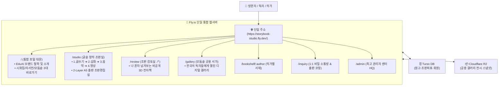

# 🚀 [EduAI & 글솥] Fly.io 단일 플랫폼 완전 통합 실행 계획서
## — Vercel 완전 폐기, 단일 도메인·단일 웹서버 원스톱 서비스 구축 마스터 플랜

> **"문은 단 하나, 방은 가장 풍성하게, 관리는 가장 가볍게!"**  
> 본 계획서는 Vercel에 분산되어 있던 껍데기 대문 홈페이지를 완전히 정리하고,  
> **Fly.io 상시대기 단 1대의 웹서버로 포털 대문, 집필실, 조판 검토실, 모둠솥 공용 서가까지 모든 생태계를 원스톱으로 흡수·단일화**하는 실행 명세를 규정합니다.

---

## Ⅰ. 추진 배경 및 방향성 확정

### 1. 현행 분산 구조의 문제점
- **Vercel의 단순 간판 역할**: 기존 메인 대문(`eduai-hub-bay.vercel.app`)은 시화집과 자서전으로 건너가는 단순 링크 배너(랜딩 페이지) 외에 고유 연산 기능이 전무함.
- **방문자 혼선 및 관리 파편화**: 화면을 이동할 때마다 도메인 주소가 널뛰어 사용자 경험이 단절되고, Vercel/Fly.io/GitHub 레포지토리가 쪼개져 유지보수 피로도가 가중됨.
- **과거 접속자 부재 (클린 상태 확인)**: 기존 Vercel 사이트는 대표님 개인 테스트 용도로만 사용되었으며 실사용자 트래픽이 없으므로, **복잡한 301 리다이렉트나 이전 유예 기간 없이 Vercel을 즉시 깔끔하게 폐기**하기로 확정.

---

## Ⅱ. 목표 아키텍처 (Before vs After)

```
[Before : 3개 서비스 분산 파편화 체제]
• 🏛️ 메인 대문 포털 : Vercel (Next.js) `eduai-hub-bay.vercel.app` (단순 링크 배너)
• ✍️ 감성 시화집    : Fly.io (Python FastAPI) `storybook-studio.fly.dev` (실제 엔진)
• 📖 온 세대 자서전  : Vercel (Next.js) 별도 호스팅
• 🗄️ 백엔드 인프라  : Turso DB + Cloudflare R2
──────────────────────────────────────────────────────────────────────────
[After : Fly.io 단일 플랫폼 완전 일원화 (Single SSOT Engine)]
• 🌐 단 1대의 통합 웹서버 : Fly.io (`https://storybook-studio.fly.dev/` 또는 대표 도메인)
• 🗄️ 단 1개의 클라우드 장부: Turso DB (libSQL, 전사 회원 및 텍스트 데이터 9GB 무료)
• 📦 단 1개의 미디어 창고 : Cloudflare R2 (전시용 고화질 삽화/음원 10GB + 다운로드 0원 무료)
• ❌ Vercel 호스팅       : 100% 완전 폐기 (관리 대상에서 영구 제거)
```

---

## Ⅲ. 단일 도메인 내부 통합 라우팅(Route) 체계

손님이 단 하나의 도메인에 접속하면, 브라우저 주소창의 이탈 없이 단일 플랫폼 내부에서 모든 여정이 물 흐르듯 완성됩니다:



---

## Ⅳ. 세부 실행 과업 명세 (Step-by-Step)

### 과업 1. 통합 메인 대문 포털(`/`) 승격 및 고도화
- **기반 파일**: 신규 통합 포털 대문 템플릿(`portal.html`) 신설.
- **화면 구성**:
  1. **헤더 & 브랜드 유입존**:
     - EduAI 슬로건: *"배움과 창작의 갈증을 가진 모든 이에게 꿈을"*
     - 브랜드 소개 및 전국 작가 사랑방 네이버 카페 링크
  2. **3대 핵심 공방 바로가기 카드 (메인 쇼케이스)**:
     - 🌸 **[✍️ 감성 시화집 '글솥' 집필실 입장]**: 삶의 기억 하나로 시와 그림, 노래, 영상을 빚고 종이책(부크크)으로 출판
     - 📖 **[온 세대 자서전 집필실]**: 마이크 구술 인터뷰로 엮는 부모님과 나의 일대기
     - 🏛️ **[전국 작가들의 모둠솥 공용 서가 둘러보기]**: 출품된 보석 같은 시화집들을 3D로 감상
  3. **3단계 안심 지원 & 자율 무료 창작 선언 (운영자 부담 원천 방어)**:
     - **자율 창작 100% 평생 무료 선언**: 글쓰기, AI 수채화 삽화, 노래 작곡, 3D 책 뷰어, 부크크 인쇄용 PDF 다운로드까지 누구나 비용 0원으로 평생 자유롭게 창작.
     - **1단계 (혼자서 척척)**: `[📖 큰 글씨 사용설명서 & 13가지 FAQ]`로 조판/저장 등 반복 질문 90% 셀프 해결.
     - **2단계 (함께 나누는 온기)**: `[☕ 공식 네이버 카페]`에서 선배 작가님들과 서로 돕고 칭찬하는 집단지성 사랑방.
     - **3단계 (기술 AS 우체통)**: 스튜디오 내부 `[💬 1:1 문의]` (원고 데이터 원클릭 첨부, 비동기 검토).
  4. **프리미엄 1:1 맞춤 출판 코칭 안내 (선택형 유료 비즈니스 모델)**:
     - *"혼자서 조판하기 눈이 침침하시거나, 완벽한 문학적 퇴고와 종이책 출판 등록 대행을 원하시는 작가님을 위한 전문가 밀착 동행 서비스"*
     - 프로그램은 평생 무료이지만, 대표님의 귀한 시간과 장인 정신이 들어가는 1:1 맞춤 교정은 정당한 유료 컨설팅으로 분리하여 대표님의 무료 봉사 피로도를 원천 차단하고 안정적 수익 모델 확보.
- **FastAPI 라우트 연결**:
  - `web/routers/auth_admin.py`의 루트(`/`) 요청 시 통합 대문(`portal.html`)을 기본 렌더링.
  - 로그인 세션이 있거나 "집필실 바로가기"를 클릭한 작가는 `/studio`로 자연스럽게 이동.

### 과업 2. Vercel 호스팅 완전 폐기 및 단일 도메인 연동
- 기존 Vercel 프로젝트(`eduai-hub-bay`)는 추가 방문자가 없으므로 리다이렉트 없이 안전하게 삭제/종료.
- 보유 중이신 대표 도메인(예: `eduai.kr` 또는 서브도메인)이 있을 경우, Fly.io 단 1곳의 IP/CNAME으로 직결.
- SSL 보안 인증서(HTTPS)는 Fly.io에서 원클릭 자동 갱신(Let's Encrypt).

### 과업 3. 온 세대 자서전(`TogetherStory`) 모듈의 글솥 단일 공방 편입 (중장기)
- 분리되어 있던 자서전 집필 로직을 글솥 스튜디오 상단의 **`[📚 집필 중인 책]` ➔ `[도서 종류: 서정 시화집 / 온 세대 자서전]`** 선택 구조로 흡수.
- 단 하나의 웹사이트, 단 하나의 데이터베이스(Turso) 안에서 시화집과 자서전을 자유자재로 집필하는 완전한 원스톱 플랫폼 달성.

---

## Ⅴ. 단일 플랫폼 인프라 삼각편대 (월 5천 원대 전사 종결)

| 인프라 계층 | 서비스 | 역할 및 스펙 | 월 고정 비용 |
| :--- | :--- | :--- | :---: |
| 🚀 **통합 웹서버** | **Fly.io** (서울/도쿄 리전) | • 메인 포털 대문 + FastAPI 백엔드<br>• 300 DPI 출판 조판 + 한글 명조 폰트 엔진<br>• 3D 전자책 뷰어 + API 일체 상시대기 | **월 약 5,000원**<br>(\$4 ~ \$5) |
| 🗄️ **클라우드 장부** | **Turso DB** (libSQL) | • 전사 작가 계정 및 원고 텍스트<br>• 2-Layer 조판 좌표 및 목차 설계도<br>• 9GB 무료 (책 수만 권 수용) | **0원 (평생 무료)** |
| 📦 **미디어 창고** | **Cloudflare R2** | • 모둠솥 공용 갤러리 전시용 삽화/낭송 스냅샷<br>• 10GB 무료 + **다운로드 트래픽 평생 0원 무제한** | **0원 (평생 무료)** |
| ❌ **구 Vercel** | — | **완전 폐기** (관리 포인트 0개) | **0원** |
| **전사 총계** | — | **단 1대의 통합 서버로 전사 생태계 24시간 완벽 가동** | **총 월 5천 원대** |

---

## Ⅵ. 기대 효과 (대표님께 드리는 3대 보장)

1. **유지보수 스트레스 제로화**:
   - 이제 Vercel을 들여다볼 필요가 없습니다. 깃허브 푸시(`git push`) 단 한 번으로 대문부터 집필실, 조판실, 갤러리까지 한 번에 무중단 배포됩니다.
2. **방문자 경험의 완벽한 일관성**:
   - 어르신들이나 지자체 수강생들에게 여러 사이트 주소를 알려드릴 필요 없이, **"이 단 하나의 주소만 기억하세요"**로 모든 안내가 끝납니다.
3. **무결성과 보안의 극대화**:
   - 인증 세션(`Cookie / Turso DB`)이 단일 도메인 안에서 100% 온전히 유지되어, 로그인 풀림이나 도메인 간 교차 출처(CORS) 오류가 원천 차단됩니다.

