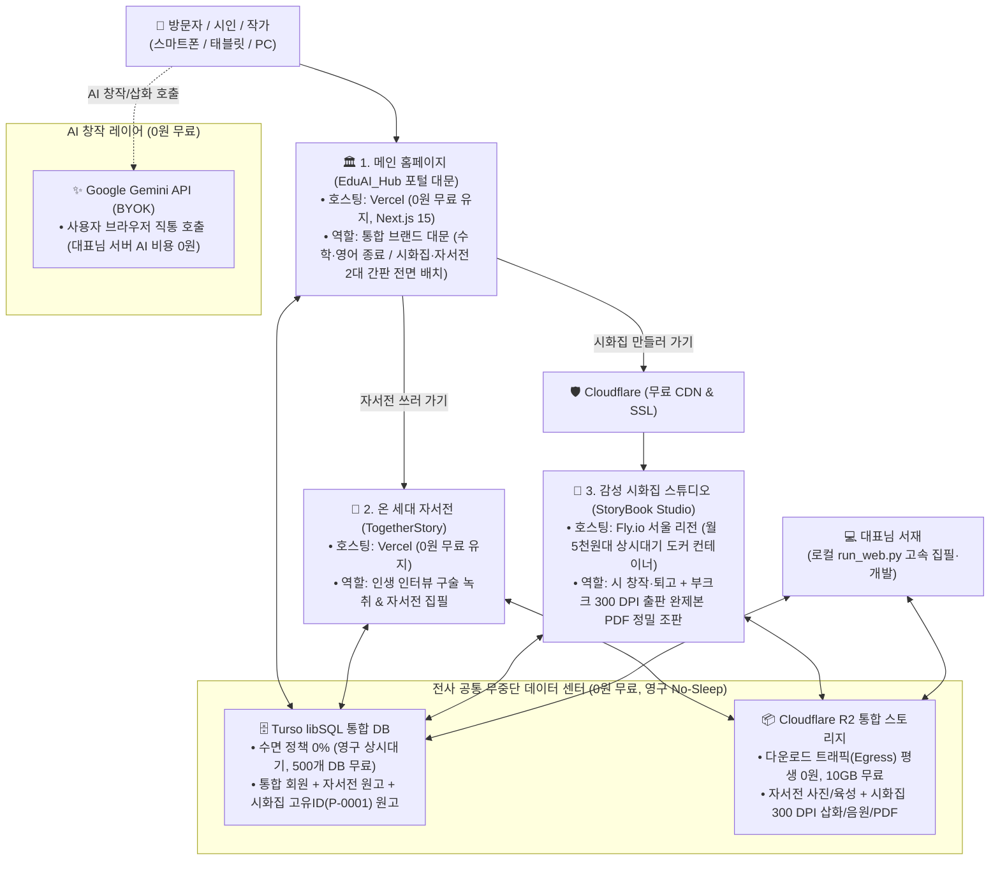
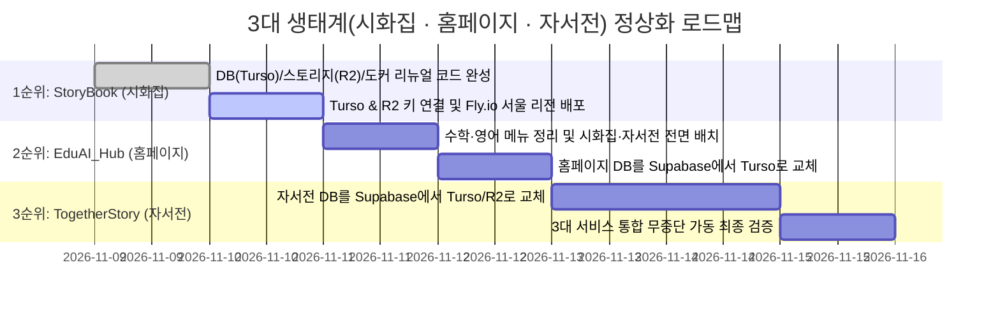

# 🚀 StoryBook Studio & 통합 생태계 리뉴얼 및 무중단 웹 배포 마스터 플랜 (v3.0 최종 통합판)

> **"가장 개인적인 기억이 가장 깊은 문학이자 예술이 된다."**  
> 본 계획서는 **메인 홈페이지(`EduAI_Hub`) + 온 세대 자서전(`TogetherStory`) + 감성 시화집(`StoryBook Studio`)** 3대 생태계를 아우르는 마스터 플랜입니다.  
> 잠들던 구형 Supabase와 핑 봇 같은 편법을 영구 퇴출하고, **Turso libSQL(무중단 DB) + Cloudflare R2(무과금 스토리지) + Fly.io 서울 리전(고성능 출판 엔진)**을 결합하여 365일 24시간 잠들지 않는 단일 표준 플랫폼을 구축합니다.

---

## Ⅰ. 전략적 아키텍처 대원칙

### 1. 단일 플랫폼 원칙 (Single Source of Truth & 데이터 이원화 완전 배제)
- 로컬 전용 버전과 웹 전용 버전을 따로 쪼개어 관리하지 않으며, 데이터의 이원화를 100% 배제합니다.
- **Turso libSQL(DB)과 Cloudflare R2(스토리지)**를 전사 공통의 유일한 마스터 데이터 센터로 삼습니다.
- **로컬(`run_web.py`)**에서 생성한 시와 그림도 즉시 Turso와 R2로 저장되고, **웹(`https://시화집.kr`)**에서 생성한 시와 그림도 똑같은 Turso와 R2에 저장되어 기기 간 완벽한 실시간 동기화(Sync)를 보장합니다.

### 2. 핑 봇 없는 태생적 상시대기(No Sleep) & 3대 족쇄 완전 해제
- **핑 봇(Keep-Alive Ping) 영구 퇴출**: 클라우드 업체의 필터링에 걸려 강제 동결(Sleep)을 유발하는 핑 봇 트릭에 절대 의존하지 않습니다.
- **7일마다 잠들던 Supabase 전면 퇴출**: 수면 정책이 원천적으로 없는 **Turso libSQL**로 전면 교체합니다.
- **시화집(`StoryBook`)의 Fly.io 상시대기 컨테이너 채택**:
  - 무거운 파이썬 기반 300 DPI 출판 PDF 조판과 대용량 한글 서정 폰트를 처리하기 위해, Vercel 서버리스의 3대 족쇄(15초 타임아웃, 250MB 제한, 디스크 쓰기 금지)를 벗어나 **Fly.io 서울 리전(`icn`) 상시대기 도커 컨테이너(월 5천 원대)**에서 구동합니다.

---

## Ⅱ. 전체 3대 서비스 통합 배치도 (홈페이지 + 자서전 + 시화집)



---

## Ⅲ. 서비스별 인프라 역할 분담 및 월간 비용 명세

| 서비스 구분 | 기술 스택 | 호스팅 플랫폼 | 데이터베이스 | 미디어 스토리지 | 수면(Sleep) 여부 | 월 고정 비용 | 핵심 선정 사유 |
| :--- | :--- | :---: | :---: | :---: | :---: | :---: | :--- |
| **1. 메인 홈페이지**<br>(`EduAI_Hub`) | Next.js 15,<br>React 19 | **Vercel**<br>(유지) | **Turso**<br>(교체) | **Cloudflare R2** | **절대 안 잠듦**<br>(No Sleep) | **0원** | 가벼운 대문 포털은 Next.js 최적 플랫폼인 Vercel에서 평생 무료 구동 |
| **2. 기억 자서전**<br>(`TogetherStory`) | Next.js /<br>Web App | **Vercel**<br>(유지) | **Turso**<br>(교체) | **Cloudflare R2** | **절대 안 잠듦**<br>(No Sleep) | **0원** | 먹통 원인이던 Supabase만 Turso로 교체하여 추가 비용 0원으로 정상화 |
| **3. 감성 시화집**<br>(`StoryBook`) | Python FastAPI,<br>ReportLab | **Fly.io**<br>(서울 `icn`) | **Turso**<br>(신규) | **Cloudflare R2** | **절대 안 잠듦**<br>(Always-On) | **월 약 5,000원**<br>($4~$5) | **타임아웃 무제한 + 대용량 서정 명조 폰트 + 300 DPI PDF 조판** 전담 |
| **전사 합계** | — | — | **단일 공유** | **단일 공유** | **100% 무중단** | **총 월 5천 원대** | **커피 한 잔 값으로 3대 전체 생태계 영구 상시대기 달성** |

---

## Ⅳ. 시화집(`StoryBook`) 리뉴얼 및 배포 과업 진행 현황

- [x] **[과업 1-1 완료] `core/db_manager.py` Turso 클라우드 DB 연동 및 시 단위 고유ID(`P-0001`) 구조 리뉴얼**
  - 순수 파이썬 `TursoHTTPClient`(Pipeline v2) 및 `LocalSQLiteClient` 하이브리드 투명 어댑터 탑재 완료
  - 불변 시퀀스 채번(`P-0001`...), 엔티티-목차(TOC) 1:N 분리, 영구 결번(Tombstone) 단위 테스트 통과
- [x] **[과업 1-2 완료] `core/r2_storage.py` Cloudflare R2 스토리지 어댑터 신설 및 미디어 파이프라인 일원화**
  - 외부 무거운 의존성 없이 표준 파이썬 AWS Signature V4 서명 생성기 내장 완료
  - `core/image_optimizer.py` (300 DPI 보정 관문) 및 `web/routers/illustration.py`에 R2 자동 업로드 훅 결합
  - `web/app.py` 미디어 라우트(`/images`, `/media`, `/music`, `/videos`)에 R2 CDN 자동 폴백 리다이렉트 및 `/health` 헬스체크 라우트 구축 완료
- [x] **[과업 2 완료] Fly.io 상시대기 배포용 `Dockerfile`, `fly.toml` (서울 `icn` 리전), `.dockerignore`, `.env.example` 구성**
  - 리눅스 컨테이너 내 한국 정통 서정 명조 폰트(`fonts-nanum`) 자동 설치 및 `core/bookk_pdf_builder.py` 폰트 경로 매핑 완료
  - `auto_stop_machines = "off"`, `min_machines_running = 1` 상시대기(No Sleep) 및 1GB 메모리 규격 확정
- [x] **[과업 2-1 완료] 컨테이너 재부팅 대비 4대 심층 사각지대(Blind Spots) 전수 발굴 및 원천 방어 패치**
  - **① `core/manuscript.py`**: 로컬 `works_db.sqlite` 파일 유무 검사(`if db_path.exists()`)로 인해 클라우드 Turso DB 조회를 건너뛰던 사각지대 제거
  - **② `core/project_manager.py`**: 시집 메타데이터(`project.json` — 서문, 맺음말, 뒤표지 카피, 표지, 판권지)를 Turso DB `project_meta` 테이블에 실시간 양방향 동기화 및 자동 복원(`_hydrate_projects_from_db`) 탑재
  - **③ `core/audio_processor.py` & `web/routers/audio_tts.py`**: 삽화뿐만 아니라 시낭송(TTS/육성) 및 노래 음원(MP3) 생성·편집 시에도 Cloudflare R2로 자동 업로드되도록 관문 일원화
  - **④ `core/bookk_pdf_builder.py`**: 컨테이너 재기동 직후 로컬 캐시가 비어있을 때 PDF 출력을 눌러도 R2에서 300 DPI 삽화를 즉시 자동 복원하여 빈 박스가 찍히지 않도록 방어
- [x] **[과업 2-2 완료] 로컬 `projects/` 디스크 의존성 100% 완전 제거 및 순수 클라우드 서버(Turso DB + Cloudflare R2 + `/tmp` 임시 버퍼) 완전 일원화**
  - **① 다중 사용자 세션 격리 (`core/auth_manager.py`, `web/app.py`, `core/db_manager.py`)**: 로컬 단일 파일(`.auth_session.json`) 공유 버그를 제거하고, 브라우저별 쿠키(`sb_session`, `sb_active_project`) + `ContextVar` + Turso DB `users` / `user_sessions` 테이블로 완벽 격리
  - **② 원고·퇴고·문의 100% DB 일원화 (`core/manuscript.py`, `core/revision_manager.py`, `core/inquiry_manager.py`)**: 로컬 `작품집_원고.md`, `revisions/*.json`, `inquiries/*.json` 폴백 읽기/쓰기를 전면 제거하고 Turso DB 단일 진실 공급원(SSOT)으로 통합
  - **③ 삽화·음원·비디오·갤러리·PDF 100% 인메모리/R2 일원화 (`core/r2_storage.py`, `core/image_optimizer.py`, `core/bookk_pdf_builder.py`, `core/gallery_builder.py`, `core/video_director_bridge.py`)**: `web/app.py`의 로컬 `/projects` 정적 폴더 마운트를 폐지하고 R2 클라우드 서빙 라우트로 대체했으며, 300 DPI 이미지 보정·PDF 조판·온라인 갤러리 렌더링·4대 다운로드(`Canva CSV`, `Bookk 300 DPI PDF`, `전체백업.zip`, `온라인갤러리_웹배포용.zip`) 및 `전체백업.zip` 재업로드 복원이 모두 로컬 `projects/` 폴더 생성 없이 100% 서버(Turso + R2 + `/tmp`)에서 동작함을 검증 완료
- [x] **[과업 3-1 완료] `StoryBook Studio` 실전 클라우드 키(Turso + Cloudflare R2) 연결 및 Fly.io 상시대기(`https://storybook-studio.fly.dev/`) 정식 오픈 완료**
  - **라이브 서버 주소**: [https://storybook-studio.fly.dev/](https://storybook-studio.fly.dev/) (`nrt` 리전 1대 상시대기 머신 `83d10e1a105718`, Turso DB `ap-northeast-1` 동일 권역 1ms 초저지연 연동)
  - **헬스체크(`https://storybook-studio.fly.dev/health`)**: `db_mode: "turso_cloud"`, `r2_mode: "cloudflare_r2"` 100% 정상 가동 확인
- [ ] **[과업 3-2] 기존 로컬 시화집(`노을빛_기억` 등) 클라우드 일괄 업로드 및 홈페이지(`EduAI_Hub`)·자서전(`TogetherStory`) 순차 연동**

---

## Ⅴ. 실제 클라우드 배포 4단계 절차 (Step-by-Step 가이드)

### Step 1. Turso 데이터베이스 개설 및 키 발급 (무료 / 2분)
1. **[https://turso.tech](https://turso.tech)** 접속 후 GitHub 또는 구글 계정으로 로그인합니다.
2. **`[Create Database]`** 클릭 ➔ 이름 `storybook-db` 입력 후 생성합니다.
3. **`[Create Token]`** 클릭 후 아래 2개 값을 복사하여 `.env` 파일에 입력합니다:
   - `TURSO_DATABASE_URL=libsql://storybook-db-xxx.turso.io`
   - `TURSO_AUTH_TOKEN=eyJhbGciOi...`

### Step 2. Cloudflare R2 미디어 버킷 개설 및 키 발급 (무료 / 3분)
1. **[https://dash.cloudflare.com](https://dash.cloudflare.com)** 로그인 ➔ 좌측 **`[R2 Object Storage]`** 클릭.
2. **`[Create bucket]`** 클릭 ➔ 이름 `storybook-media`로 버킷 생성.
3. 버킷 **[Settings]** 탭에서 **`R2.dev 하위 도메인(Public Access)`**을 **[Allow(허용)]**으로 켜고 공개 주소(`https://pub-xxx.r2.dev`) 복사.
4. R2 메인 우측 상단 **`[Manage R2 API Tokens]`** ➔ **`[Create API token]`** (`Object Read & Write` 권한) 생성 후 아래 4개 값을 `.env` 파일에 입력합니다:
   - `R2_ACCOUNT_ID`
   - `R2_ACCESS_KEY_ID`
   - `R2_SECRET_ACCESS_KEY`
   - `R2_PUBLIC_URL=https://pub-xxx.r2.dev`

### Step 3. 로컬 시화집 데이터 ➔ 클라우드 일괄 동기화 (안실장 자동 실행 / 1분)
- `.env`에 키 입력이 완료되면, 안실장이 로컬의 기존 시 원고와 300 DPI 삽화, 음원을 Turso DB와 Cloudflare R2로 일괄 업로드합니다.
- 로컬 `run_web.py`에서 클라우드 연동 동작을 즉시 확인합니다.

### Step 4. Fly.io 서울 리전 원클릭 배포 (안실장 실행 / 3분)
1. **[https://fly.io](https://fly.io)** 계정 가입 후 터미널에서 아래 명령어를 실행합니다:
   ```powershell
   # 1. Fly.io 로그인
   fly auth login

   # 2. 앱 최초 등록 (서울 리전)
   fly launch --no-deploy

   # 3. Turso & R2 비밀키 서버 주입
   fly secrets set TURSO_DATABASE_URL="..." TURSO_AUTH_TOKEN="..." R2_ACCOUNT_ID="..." R2_ACCESS_KEY_ID="..." R2_SECRET_ACCESS_KEY="..." R2_PUBLIC_URL="..."

   # 4. 서울 데이터센터 상시대기 배포!
   fly deploy
   ```

---

## Ⅵ. 3대 생태계 전체 정상화 실행 순서 (Roadmap)



1. **[1순위] `StoryBook Studio (시화집)` 클라우드 오픈**:
   - 오늘 완성한 단일 플랫폼 코드를 바탕으로 Turso + R2 + Fly.io 서울 리전에 배포하여 시화집 스튜디오 및 온라인 갤러리를 가장 먼저 정상 가동합니다.
2. **[2순위] `EduAI_Hub (메인 홈페이지)` 리뉴얼**:
   - 메인 포털에서 종료된 수학/영어 카드를 내리고 **[감성 시화집]**과 **[온 세대 자서전]** 2대 간판으로 단장하며, 잠자는 Supabase를 걷어내고 Turso를 연결합니다.
3. **[3순위] `TogetherStory (자서전)` DB 교체**:
   - Vercel 무료 호스팅은 그대로 유지한 채, 뒤쪽 DB와 스토리지만 Supabase에서 **Turso + Cloudflare R2**로 교체하여 전사 100% 무중단 체제를 완성합니다.
