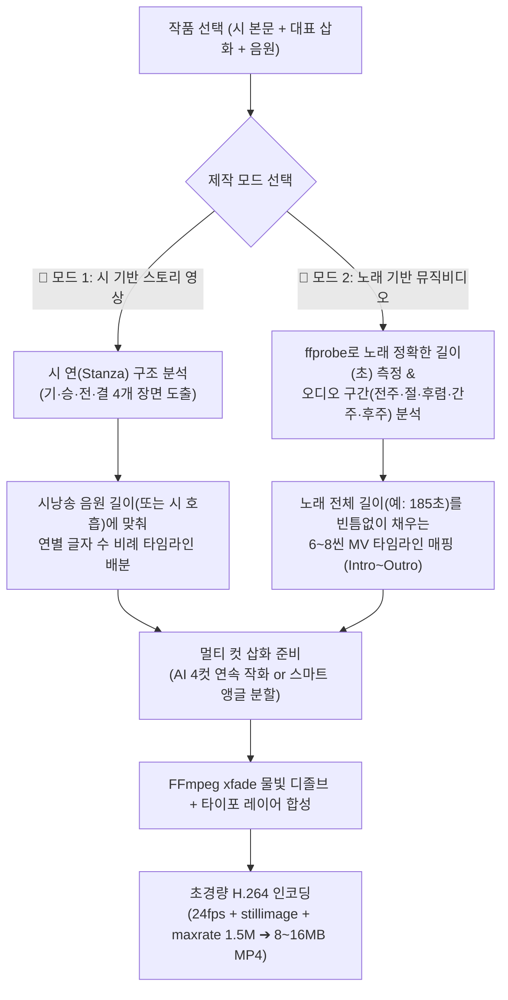

# 🎬 시(詩) 스토리 영상 & 노래 뮤직비디오(MV) 2원화 경량 엔진 구현 계획서

> **기획 목적**  
> 기존 비디오 기능의 한계였던 **① 단조로운 연출(그림 1장만 확대/축소 반복)**과 **② 비정상적인 파일 용량(약 120MB)** 문제를 근본적으로 해결하고, 사용자의 목적에 따라 **① 「시(詩) 기반 스토리 영상 모드」**와 **② 「노래 기반 뮤직비디오(MV) 모드 (노래 전곡 길이 100% 동기화)」**로 이원화된 **8~15MB 초경량 고화질 영상 엔진(v2.0)**을 구축합니다.

---

## 1. 기존 비디오 기능을 철회했던 원인 정밀 진단

현재 코드베이스([`core/video_renderer.py`](file:///d:/AG/StoryBook/core/video_renderer.py))를 분석한 결과, 실망스러웠던 원인은 다음 두 가지입니다.

### ① 서사(Story)와 음악적 호흡의 부재: "3분 내내 그림 1장만 흔들림"
* 시에는 **[기·승·전·결]**의 서사가 있고, 노래에는 **[전주(Intro) ➔ 1절(Verse) ➔ 후렴(Chorus) ➔ 간주 ➔ 2절 ➔ 클라이맥스 ➔ 후주(Outro)]**의 다이내믹한 흐름이 있습니다.
* 그러나 기존 렌더러는 오직 **단 1장의 이미지(`image_path`)**만 입력받아 `-loop 1`로 고정한 뒤, `sin(t*0.08)`, `cos(t*0.06)` 수학 함수로 3분 내내 화면을 좌우로 흔들기만 했습니다.

### ② 용량 폭증(120MB): "수채화 종이 질감의 매 프레임 재인코딩"
* 300 DPI 수채화·수묵담채 삽화에는 미세한 **한지 결(Paper Grain)**이 전체 픽셀에 깔려 있습니다.
* 기존 코드는 `1920x1080` 해상도에서 `30fps`로 **매 프레임(1초에 30번)마다 전체 픽셀을 소수점 단위로 이동**시키면서 `-crf 21 -preset fast`(고비트레이트·저압축)로 인코딩했습니다.
* H.264 코덱이 한지 질감의 미세 이동을 ‘화면 전체의 급격한 변화’로 오인하여 비트레이트가 **5~8 Mbps(3분 기준 100~130MB)**까지 폭증했습니다.

---

## 2. 핵심 설계: 「시 기반 영상」 vs 「노래 기반 뮤직비디오」 2원화 아키텍처

시낭송과 노래(뮤직비디오)는 길이와 호흡, 감상 포인트가 완전히 다르므로 렌더링 엔진과 스토리보드 디렉터를 **2가지 전용 모드**로 이원화합니다.

| 비교 항목 | 📖 **모드 1: 시(詩) 기반 스토리 영상** *(Poetry Storyboard Film)* | 🎵 **모드 2: 노래 기반 뮤직비디오 (MV)** *(Song-Synced Music Video)* |
| :--- | :--- | :--- |
| **기준 오디오 및 총 길이** | **시낭송 음원(AI 성우 / 육성 녹음)** 길이 맞춤 *(음원 없을 시 시 길이에 맞춰 45~80초 자동 설정)* | **노래 음원(Suno / Colab MP3·WAV) 실제 재생 길이에 0.1초 단위까지 100% 정확히 맞춤** *(예: 2분 40초 ~ 3분 30초)* |
| **장면(Scene) 분할 기준** | **시의 연(Stanza: 1연·2연·3연·4연)** 단위 *(연별 글자 수·낭송 호흡에 비례해 시간 배분)* | **악곡 구조(`[Intro] ➔ [Verse 1] ➔ [Chorus] ➔ [Verse 2] ➔ [Bridge] ➔ [Chorus 2] ➔ [Outro]`)** 및 오디오 에너지(파형) 분석 |
| **화면 전환 템포 & 컷 수** | **4컷 구성** (컷당 12~18초의 차분하고 명상적인 호흡) | **6~8씬 시퀀스 구성** (노래가 길어도 지루하지 않도록 18~25초마다 컷 전환 및 후렴구 감성 앵글 리프라이즈) |
| **텍스트(시구절/가사) 연출** | 한지 여백 위에 **각 연(Stanza)의 원문 시 구절**이 정통 명조/붓글씨체로 고요하게 피어남 | • **전주(Intro)**: 곡 제목·시인 이름 타이틀 카드 • **절/후렴**: 노래 진행에 맞춘 **서정 리릭(Lyric) 구절 페이드 연출** *(On/Off 가능)* |
| **시각 효과 (Visual FX)** | 담백한 물빛 크로스 디졸브(`2.5초`) + 정적인 슬로우 포커스 | • **절(Verse)**: 차분한 수채화 패닝 • **후렴(Chorus)**: 따스한 빛무리(Bokeh/햇살 번짐) 강조 및 와이드 줌아웃으로 음악적 감동 극대화 |
| **예상 파일 용량** | **약 4 MB ~ 8 MB** (1분~1분 30초 기준) | **약 10 MB ~ 16 MB** (3분 완곡 Full HD 1080p 기준 — 기존 120MB 대비 **90% 절감**) |

---

## 3. 이원화 엔진의 작동 흐름도 (Dual Pipeline)

---

## 4. 단계별 상세 구현 명세

### [1단계] AI 스토리보드 & MV 디렉터 (`core/video_storyboard_director.py` 신설)

#### ① 「시 기반 스토리 영상」 디렉팅 로직
1. 시 본문을 연(Stanza) 단위로 분석하여 **기(도입) · 승(전개) · 전(전환) · 결(여운) 4개의 핵심 장면**을 도출합니다.
2. 각 연의 음절 수와 행간(0.8초)·연간(1.5초) 호흡 비율을 계산하여 시낭송 음원의 전체 시간(`duration_sec`) 안에서 각 장면이 시작하고 끝나는 시간을 정확히 배분합니다.
3. 대표 삽화(`image_path`)의 화풍·색채·시대 배경을 고정(`Style & Setting Lock`)한 채, 나머지 장면들의 연속 삽화 프롬프트를 생성합니다.

#### ② 「노래 기반 뮤직비디오(MV)」 디렉팅 로직 (노래 길이 100% 동기화)
1. **노래 길이 정밀 측정 및 구간 분할**:
   - `ffprobe`와 `wave`/`audio_processor`를 통해 노래 파일(`.mp3`/`.wav`)의 **정확한 재생 시간(예: `174.5초`)**과 볼륨 에너지 변화를 읽어냅니다.
   - 작품에 저장된 노랫말(`lyrics`의 `[Intro]`, `[Verse]`, `[Chorus]`, `[Bridge]`, `[Outro]` 태그)과 노래 길이를 매칭하여 **노래 시작(0.0초)부터 끝(174.5초)까지 단 1초의 끊김이나 남는 시간 없이 꽉 채우는 6~8씬 타임라인**을 자동 설계합니다.
2. **노래 길이에 맞춘 6~8씬(Scenes) MV 시퀀스 예시 (3분 = 180초 노래 기준)**:
   - **Scene 1 `[Intro 전주: 0~18초]`**: 대표 삽화 블러 배경 위 **「곡 제목 & 시인 이름」 한지 타이틀 카드** ➔ 본 그림으로 서서히 포커스 인
   - **Scene 2 `[Verse 1 (1절): 18~50초]`**: **[기(도입) 삽화]** (새벽 안개 낀 고향 들판 원경) + 1절 핵심 가사 구절 오버레이
   - **Scene 3 `[Chorus 1 (1절 후렴): 50~85초]`**: **[승(전개) 삽화]** (어머니의 손과 봄나물 클로즈업) + 따스한 햇살 빛무리 효과 + 후렴 가사
   - **Scene 4 `[Interlude & Verse 2 (간주·2절): 85~120초]`**: **[전(전환) 삽화]** (저녁 연기 피어오르는 고향집 마당) + 2절 가사
   - **Scene 5 `[Chorus 2 (클라이맥스 후렴): 120~155초]`**: **[결(정점) 삽화]** (꽃잎 흩날리는 봄날의 전경 와이드 줌아웃) + 후렴 가사
   - **Scene 6 `[Outro (후주 및 여운): 155~180초]`**: **[여운 에필로그 컷]** (빈 마루의 바구니와 한지 여백) + 오디오 페이드아웃(`2.5초`)과 함께 영상 마무리

---

### [2단계] 장면 이미지 확보 방식 (사용자 선택 옵션 제공)
영상을 만들 때 대기 시간과 연출 밀도를 사용자가 직접 고를 수 있도록 옵션을 제공합니다.

* **옵션 1: 🎨 [AI 멀티컷 스토리보드 생성] (권장)**
  - 기존 대표 삽화(1컷) 및 2부 삽화 외에, 스토리에 필요한 **추가 장면 삽화(2~3컷)를 동일 화풍·동일 색감으로 자동 생성**하여 진짜 그림책/애니메이션처럼 장면이 바뀌는 영상을 제작합니다.
* **옵션 2: ⚡ [기존 삽화 시네마틱 분할] (15초 즉시 완성)**
  - 추가 이미지 생성 대기 시간 없이, 이미 만들어진 대표 삽화(1~2장)에서 **전체 원경 / 상단 배경 포커스 / 핵심 피사체 클로즈업 / 한지 시구절 간지 카드**를 다중 크롭·재구성하여 즉시 6~8씬 영상을 렌더링합니다.

---

### [3단계] 120MB ➔ 10MB 초경량 고화질 인코딩 파이프라인 (`core/video_renderer.py` 개편)
노래 길이가 3~4분으로 길어져도 파일 크기가 **10MB ~ 16MB**를 절대 넘지 않도록 FFmpeg 인코딩 엔진을 전면 재설계합니다.

1. **떨림 없는 단방향 슬로우 카메라 무빙**:
   - 기존의 어지럽고 용량을 잡아먹던 `sin(t)/cos(t)` 무한 왕복 흔들림을 제거하고, 각 씬마다 부드러운 단방향 줌/패닝만 적용합니다.
2. **수채화/시화 전용 5대 압축 플래그 적용**:
   - `-r 24`: 영화 표준 24 프레임 (프레임 수 20% 절감)
   - `-tune stillimage`: 수채화 여백 및 일러스트 질감 압축 최적화 (비트레이트 60% 절감)
   - `hqdn3d=1.5:1.5:6:6`: 한지 결의 미세 픽셀 노이즈 안정화
   - `-crf 26 -preset medium -maxrate 1.5M -bufsize 3M`: Full HD(1080p) 선명도는 유지하면서 최대 비트레이트를 1.5Mbps로 제한
   - `-shortest` & 정확한 `-t {song_duration}`: 노래가 끝나는 정확한 시각에 오디오 페이드아웃(`afade`)과 비디오 페이드아웃(`fade`)이 동시에 맞물려 종료

---

## 5. 수정 및 구현 대상 파일 목록

| 순서 | 대상 파일 | 세부 구현 내용 |
| :---: | :--- | :--- |
| **1** | [`core/video_storyboard_director.py`](file:///d:/AG/StoryBook/core/video_storyboard_director.py) *(신규)* | • **시 기반 모드**: 연(Stanza) 분석 ➔ 기·승·전·결 4컷 스토리보드 & 낭송 타임라인 생성 • **노래 MV 모드**: 노래 길이(`duration`) 100% 동기화 + `[Intro]~[Outro]` 6~8씬 MV 타임라인 & 가사/타이틀 매핑 |
| **2** | [`core/video_renderer.py`](file:///d:/AG/StoryBook/core/video_renderer.py) *(전면 개편)* | • 다중 씬 이미지 합성 + Pillow 기반 한지 타이틀/시구절/노랫말 타이포그래피 오버레이 • FFmpeg `xfade`(물빛 디졸브) + 초경량 인코딩(`8~16MB`) 파이프라인 구현 |
| **3** | [`web/routers/audio_video.py`](file:///d:/AG/StoryBook/web/routers/audio_video.py) | • `/api/preview_video_storyboard` (시 스토리 모드 / 노래 MV 모드별 장면 구성 미리보기 API) • `/api/render_video` (2원화 모드, 멀티컷 생성 여부, 시구절/가사 표시 여부 파라미터 연동) |
| **4** | [`web/templates/index.html`](file:///d:/AG/StoryBook/web/templates/index.html) & [`app.js`](file:///d:/AG/StoryBook/web/static/js/app.js) | • **[📖 시 스토리 영상 만들기]** vs **[🎵 노래 뮤직비디오 만들기]** 2원화 탭/버튼 UI 구성 • 노래 선택 시 실제 노래 길이(예: `02:54`) 자동 표시 및 완성 후 내장 비디오 플레이어 감상·다운로드 지원 |
| **5** | [`지자체_문화교육_12주_강의계획서.md`](file:///d:/AG/StoryBook/%EC%A7%80%EC%9E%90%EC%B2%B4_%EB%AC%B8%ED%99%94%EA%B5%90%EC%9C%A1_12%EC%A3%BC_%EA%B0%95%EC%9D%98%EA%B3%84%ED%9A%8D%EC%84%9C.md) | • 9주차 커리큘럼에 **「시 스토리 영상 & 노래 뮤직비디오(MP4) 제작 및 온라인 시화전」** 반영 |
