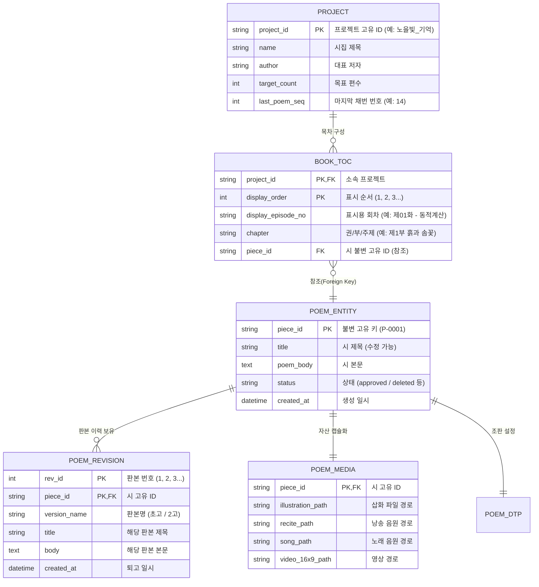

# 📑 [설계 계획서] 작품 단위 고유 불변 ID(P-0001) 기반 데이터베이스(DB) 구축 및 아키텍처 개편안

> **문서 번호**: PLAN-20261108-DB01  
> **작성 일시**: 2026년 11월 8일  
> **작성자**: StoryBook Studio 아키텍트 (안실장)  
> **상태**: 사용자 검토 및 승인 대기 (Draft for Review)  

---

## 1. 추진 배경 및 문제 정의

### 1.1 현상과 고통 (Pain Points)
- **순번 기반 취약성(Tight Coupling)**: 기존 시스템은 원고 목차의 순번(`제01화`, `01`)을 시의 식별자이자 파일명(`01_낭송.wav`, `01_음원.mp3`, `images/01_밍밭에서.jpg`)으로 사용해 왔습니다.
- **연쇄적 데이터 파괴**:
  1. 시집 목차(차례)의 순서를 바꾸거나,
  2. 중간에 시를 추가·삭제하거나,
  3. 전체 14편 중 6편을 뽑아 선집(샘플집)을 분리할 때마다,  
  기존 순번과 새 순번이 엇갈리며 **엉뚱한 시낭송/음원이 재생되고 비디오 링크가 꼬이는 치명적인 혼선**이 발생했습니다.
- **제목 변경 시의 식별자 붕괴**:
  - 만약 슬러그 형태의 ID(`poem_mingbat`)를 쓸 경우, 시인이 퇴고 과정에서 제목을 `밍밭에서` ➔ `가을 밍밭과 어머니`로 바꾸면 식별자 자체가 흔들리거나 의미 불일치가 발생합니다.

### 1.2 아키텍처 혁신 원칙 (Core Principles)
1. **불변 대리 키 (Surrogate Sequence Key)**:
   - 시 제목, 순서, 내용과 완전히 무관한 **독립적인 고유 번호(예: `P-0001`, `P-0002`...)**를 영구 식별자로 사용합니다.
   - 새 시가 생성되어 웹 화면에서 **`[본문원고 우선 저장하기]` 버튼을 누르는 순간 자동으로 채번(ID Generation)**되어 DB에 영구 고정됩니다.
2. **영구 결번 (Tombstone / Soft Delete) 정책**:
   - 어떤 시가 삭제되더라도 해당 ID 번호는 절대 재사용되지 않고 **영구 결번(Retired ID)**으로 남깁니다.
   - 이를 통해 외래키 참조 무결성을 보장하고 과거 이력과의 충돌을 원천 차단합니다.
3. **엔티티(Entity)와 책 목차(Table of Contents)의 완전한 분리**:
   - **시 엔티티(Poem Entity)**: 시 본문, 퇴고 이력, 삽화, 낭송 음원, 노래, 영상, DTP 조판 정보 일체가 `piece_id` 하나에 영구 캡슐화됩니다.
   - **책 목차(Book TOC)**: 책의 차례는 단순히 시 ID들의 정렬된 참조 배열(`order: ["P-0004", "P-0006", "P-0009", ...]`)에 불과합니다.
   - 목차 순서를 100번 바꾸든, 다른 프로젝트에서 6편만 골라 선집을 만들든, **시 자체의 파일이나 데이터는 단 1바이트도 수정되지 않으며 결코 꼬이지 않습니다.**

---

## 2. 관리 대상 요소 (필드) 상세 정의

하나의 작품 단위(Piece Entity: 시·수필·동화·서정 산문)가 생성부터 출판까지 거치면서 관리해야 할 8대 영역 35개 필드의 범용 표준 규격입니다.

| 영역 | 필드명 (Field) | 데이터 타입 | 설명 및 예시 |
| :--- | :--- | :--- | :--- |
| **1. 식별 및 생명주기** | `piece_id` **(PK)** | `VARCHAR(16)` | **불변 고유 키** (예: `P-0001`, `P-0002`) |
| | `project_id` **(FK)** | `VARCHAR(64)` | 소속 마스터 프로젝트 ID (예: `노을빛_기억`) |
| | `status` | `VARCHAR(20)` | `draft`(초고) \| `revising`(퇴고중) \| `approved`(승인완료) \| `published`(출판완료) \| `deleted`(영구결번) |
| | `created_at` | `DATETIME` | 최초 생성 일시 ([본문원고 우선 저장] 시점) |
| | `updated_at` | `DATETIME` | 최종 수정 일시 |
| **2. 문학 원고 기본** | `title` | `VARCHAR(128)` | 시 제목 (자유롭게 수정 가능, ID에 영향 없음) |
| | `subtitle` | `VARCHAR(256)` | 시 부제 또는 한 줄 서정 카피 |
| | `author` | `VARCHAR(64)` | 개별 시인/필자명 (비워둘 시 프로젝트 대표 저자) |
| | `poem_body` | `TEXT` | 최종 확정된 시 본문 전체 텍스트 |
| | `chapter_topic` | `VARCHAR(64)` | 권/부 주제 (예: `제1부: 흙과 솜꽃`) |
| | `memory_anchor` | `TEXT` | 기억의 중심 (인터뷰에서 발굴된 실제 장소·사물·행동) |
| | `interview_notes` | `TEXT` | 심층 인터뷰 질의응답 및 감각 디테일 메모 |
| **3. 퇴고 및 판본 이력** | `revisions` | `JSON` | 판본 스냅샷 배열 (`rev_id`, `version_name`, `title`, `body`, `diff`, `created_at`, `note`) |
| | `current_rev_id` | `INT` | 현재 채택된 판본 번호 (기본 1) |
| **4. 삽화 (시각 자산)** | `art_style` | `VARCHAR(32)` | 화풍 (`watercolor` \| `ink_wash` \| `oil` \| `pastel` \| `sketch`) |
| | `art_direction` | `TEXT` | 시각 구도 및 정서 연출 지침 |
| | `illustration_prompt`| `TEXT` | AI 이미지 생성 프롬프트 (영어/한국어 원문) |
| | `image_file` | `VARCHAR(256)` | 대표 삽화 상대 경로 (예: `media/P-0001/illustration.jpg`) |
| | `image_file_2` | `VARCHAR(256)` | 4P 모드 후반부 삽화 상대 경로 |
| **5. 시낭송 다중 트랙**<br>**(육성/TTS/SUNO/BGM)** | `recite_primary_type` | `VARCHAR(20)` | **현재 대표 채택 낭송 유형** (`user_voice` \| `ai_tts` \| `suno_spoken` \| `bgm_mixed`) |
| | `voice_user_file` | `VARCHAR(256)` | **[1] 시인 육성 녹음**: 마이크 직접 녹음/업로드 원본 (예: `media/P-0001/voice_user.wav`) |
| | `voice_tts_file` | `VARCHAR(256)` | **[2] AI TTS 낭송**: Gemini 2.5/3.8 Flash 서정 시낭송 (예: `media/P-0001/voice_tts.wav`) |
| | `voice_tts_actor` | `VARCHAR(32)` | TTS 성우 (`charon_male` 남성저음 \| `aoede_female` 여성온기 \| `duet` 남녀교송) |
| | `voice_suno_file` | `VARCHAR(256)` | **[3] SUNO 성우 낭송**: Suno Spoken Word / 감성 음성 (예: `media/P-0001/voice_suno.mp3`) |
| | `voice_suno_prompt`| `TEXT` | SUNO 낭송 프롬프트 및 음성 스타일 태그 (Melodic Spoken, Warm Voice 등) |
| | `voice_bgm_file` | `VARCHAR(256)` | **[4] BGM 결합 낭송**: 낭송 음원 + 잔잔한 연주 배경음 믹싱본 (예: `media/P-0001/voice_bgm.wav`) |
| | `recite_script` | `TEXT` | 낭송 전처리 스크립트 (연간 1.5초 쉼, 행간 0.8초 여백, 110~130음절/분 쉼표 규격) |
| | `recite_tempo` | `FLOAT` | 낭송 속도 배율 (기본 1.0) |
| | `recite_variants` | `JSON` | 성우/버전별 전체 음원 경로 맵 (`{"user": "...", "tts_charon": "...", "tts_aoede": "...", "suno_spoken": "...", "bgm_mixed": "..."}`) |
| **6. 작곡/노래 음원** | `music_file` | `VARCHAR(256)` | 대표 노래 음원 경로 (예: `media/P-0001/song.mp3`) |
| | `lyrics` | `TEXT` | 노랫말/가사 전문 ([Intro], [Verse], [Chorus] 메타태그 포함) |
| | `music_genre` | `VARCHAR(32)` | 음악 장르 (`folk` \| `dongyo` \| `gagok` \| `minyo`) |
| | `music_prompt` | `TEXT` | Suno/Udio 작곡 생성 프롬프트 및 태그 |
| | `music_bpm` | `INT` | 템포 (기본 70~85 BPM) |
| **7. 서정 비디오** | `video_file_16x9` | `VARCHAR(256)` | 유튜브/갤러리용 16:9 MP4 (예: `media/P-0001/video_16x9.mp4`) |
| | `video_file_9x16` | `VARCHAR(256)` | 쇼츠/릴스용 9:16 MP4 (예: `media/P-0001/video_9x16.mp4`) |
| | `video_preview` | `VARCHAR(256)` | 영상 썸네일 이미지 경로 |
| **8. 출판 DTP 조판** | `layout_mode` | `VARCHAR(20)` | `compact` (1P 맞춤) \| `multi_page` (2P 연속) |
| | `page_count` | `INT` | 할당 페이지 수 (기본 2 또는 4) |
| | `part2_mode` | `VARCHAR(20)` | `motif_symbol` \| `image` \| `pure_blank` \| `poem_text` |
| | `layout_config` | `JSON` | 글자크기(pt), 줄간격, 정렬, 여백, 행 용량 등 세부 조판 설정 |

---

## 3. 데이터베이스(DB) 및 파일 시스템 아키텍처

### 3.1 ER 다이어그램 (Entity-Relationship)



### 3.2 물리적 디렉토리 캡슐화 구조 (Folder Structure)

파일 이름에 숫자가 붙던 방식을 폐기하고, **시 고유 ID 디렉토리 아래에 역할별 고정 파일명으로 캡슐화**합니다.

```
projects/노을빛_기억/
├── project.json                 # 프로젝트 메타데이터 및 last_poem_seq 카운터
├── toc.json                     # [책 목차 테이블] piece_id 순서 배열 정의
├── works_db.sqlite              # [핵심 DB] SQLite 단일 파일 데이터베이스
├── works_db.json                # [백업/휴대용] Human-Readable JSON 내보내기
│
├── media/                       # 시 단위 독립 미디어 저장소
│   ├── P-0001/               # [P-0001] 전용 디렉토리 (영구 불변)
│   │   ├── illustration.jpg     # 대표 삽화
│   │   ├── illustration_2.jpg   # 4P 모드 후반 삽화 (선택)
│   │   │
│   │   ├── voice_user.wav       # [1. 육성] 시인 직접 마이크 녹음본
│   │   ├── voice_tts.wav        # [2. TTS] AI 성우 낭송본 (기본)
│   │   ├── voice_tts_charon.wav # [2. TTS] 남성 성우 (Charon 저음)
│   │   ├── voice_tts_aoede.wav  # [2. TTS] 여성 성우 (Aoede 온기)
│   │   ├── voice_tts_duet.wav   # [2. TTS] 남녀 교송/듀엣
│   │   ├── voice_suno.mp3       # [3. SUNO] Suno Spoken Word 감성 성우 낭송본
│   │   ├── voice_bgm.wav        # [4. BGM합성] 낭송 + 잔잔한 배경음 믹싱본
│   │   │
│   │   ├── song.mp3             # [가창] Suno 정통 작곡 가창 음원
│   │   ├── video_16x9.mp4       # 16:9 서정 비디오
│   │   └── video_preview.png    # 비디오 썸네일
│   │
│   ├── P-0002/
│   │   └── ...
│   └── P-0004/ (밍밭에서)
│       └── ...
│
└── revisions/                   # 시 단위 퇴고 판본 저장소
    ├── P-0001.json
    ├── P-0002.json
    └── P-0004.json
```

---

## 4. 핵심 생명주기 및 규칙 (Lifecycle Rules)

### 4.1 신규 시 생성 및 ID 채번 규칙 ([본문원고 우선 저장하기])
1. 사용자가 웹 집필실에서 시를 짓고 **`[본문원고 우선 저장하기]`** 버튼을 클릭합니다.
2. 서버는 `project.json` 또는 DB의 시퀀스 카운터(`last_poem_seq`)를 1 증가시킵니다.
   - 예: 기존 14번까지 채번되어 있다면 ➔ `new_id = 15`
3. 규격화된 ID 코드 생성: `P-` + 4자리 0 채움 ➔ **`P-0015`**
4. DB에 `P-0015` 레코드가 생성되고, `toc.json`(목차 테이블)의 맨 끝에 `P-0015`가 추가됩니다.
5. 이후 사용자가 제목을 `밍밭`에서 `다래꽃 핀 밍밭`으로 수정하더라도, **`P-0015` 키는 100년이 지나도 절대 바뀌지 않습니다.**

### 4.2 삭제 및 영구 결번 (Tombstone) 정책
1. 사용자가 특정 시(예: `P-0003`)를 삭제합니다.
2. `toc.json`(목차)에서 `P-0003` 항목만 제거됩니다.
   - 목차의 다음 시들이 한 칸씩 앞으로 당겨지며, 화면에 표시되는 회차(`제03화`, `제04화`...)는 동적으로 재계산됩니다.
3. **DB 및 파일 시스템 처리**:
   - `works_db.sqlite`에서 `P-0003`의 상태를 `deleted`로 업데이트합니다 (Soft Delete).
   - `last_poem_seq` 카운터는 절대 감소하지 않습니다.
   - **`P-0003`은 영구 결번으로 동결**되며, 이후 새로운 시가 추가되어도 결번된 `P-0003`을 재사용하지 않고 `P-0016`으로 넘어갑니다.
   - 이를 통해 과거 백업본, 외부 링크, 로그 데이터와의 키 충돌을 100% 방지합니다.

### 4.3 선집 / 샘플집 추출 (Showcase Project Creation)
- `노을빛_기억`(14편)에서 대표 시 6편(밍밭에서, 물레질, 다듬이질, 따순굼턱, 아리랑쓰리랑, 도토리묵)을 골라 `샘플_기억상자` 프로젝트를 만들 때:
  - 파일을 수작업으로 복사하거나 파일명을 `01`, `02`로 변경하지 않습니다.
  - 새 프로젝트의 `toc.json`에 원본 ID를 그대로 등록합니다:
    ```json
    {
      "project_name": "샘플_기억상자",
      "items": [
        { "display_order": 1, "piece_id": "P-0004", "chapter": "제1부: 흙과 솜꽃" },
        { "display_order": 2, "piece_id": "P-0006", "chapter": "제1부: 흙과 솜꽃" },
        { "display_order": 3, "piece_id": "P-0009", "chapter": "제1부: 흙과 솜꽃" },
        { "display_order": 4, "piece_id": "P-0011", "chapter": "제2부: 밤을 잣는 손" },
        { "display_order": 5, "piece_id": "P-0012", "chapter": "제2부: 밤을 잣는 손" },
        { "display_order": 6, "piece_id": "P-0010", "chapter": "제2부: 밤을 잣는 손" }
      ]
    }
    ```
  - 플레이어나 갤러리는 이 `piece_id`를 조회하여 정확한 미디어 파일을 스트리밍하므로 **어떠한 오디오 꼬임도 원천적으로 불가능**해집니다.

---

## 5. 단계별 구현 및 마이그레이션 로드맵

| 단계 | 작업 내용 | 검증 및 산출물 | 소요 예상 |
| :---: | :--- | :--- | :---: |
| **Phase 1** | **DB 엔진 구축 및 스키마 생성**<br>• `core/db_manager.py` (SQLite & JSON 이중화 관리자 개발)<br>• 시퀀스 채번기(`Sequence Generator`) 및 Tombstone 로직 구현 | `storybook.db` 스키마 테스트 통과 | 즉시 |
| **Phase 2** | **기존 프로젝트 무손실 마이그레이션 (Data Migration)**<br>• 원본 `노을빛_기억`(14편)의 시마다 `P-0001`~`P-0014` 불변 ID 발급<br>• `샘플_기억상자`(6편)의 TOC 매핑 및 미디어 파일 캡슐화 | 14편 + 6편 전수 MD5 일치 확인 | 1단계 직후 |
| **Phase 3** | **API 및 코어 엔진 연동**<br>• `core/manuscript.py`를 `db_manager` 기반으로 리팩토링<br>• 웹 엔드포인트 `[본문원고 우선 저장]` 시 `piece_id` 발급 및 연동<br>• 목차 순서 변경(Reorder) API 구축 | 웹 UI에서 저장 및 순서 변경 테스트 | 2단계 직후 |
| **Phase 4** | **갤러리 및 비디오 스튜디오 연동 검증**<br>• `시화집_갤러리.html`이 순번 대신 `piece_id`로 오디오/비디오 요청하도록 수정<br>• 비디오 스트리밍 엔드포인트(`stream_poem_video`)의 ID 지원 | 6편 시낭송/영상 100% 정상 재생 확인 | 최종 |

---

## 6. 결론 및 건의

사용자님께서 지적해 주신 **"고유 ID 채번 + 시 제목 수정 무관 + 영구 결번 + TOC 분리"** 구조는 상용 출판 및 콘텐츠 관리 시스템(CMS)의 표준입니다.

본 설계 계획서가 승인되면, 기존 14편의 원고와 미디어를 1바이트도 다치지 않게 안전하게 격리 보존한 뒤 **Phase 1(DB 엔진 구축) 및 Phase 2(마이그레이션)**를 신속하고 완벽하게 수행하겠습니다.

검토 후 수정이나 보완이 필요한 부분이 있으시면 편하게 말씀해 주십시오.

