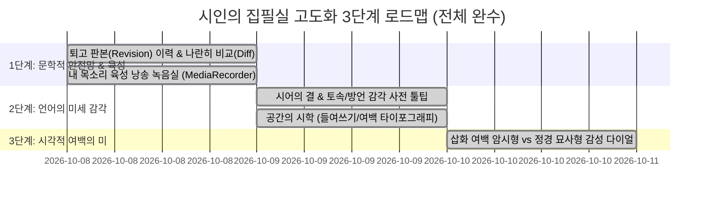

# [실행 계획서] 시인의 집필실(Poet's Atelier) 감성 고도화

> **“생산의 도구를 넘어, 시인의 사유와 숨결이 머무는 문학 사랑방으로.”**  
> 본 계획서는 스토리북 스튜디오를 단순한 디지털 독립출판 제작기를 넘어, 실제 시를 짓고 깎아내는 창작자(시인)의 섬세한 호흡과 불안, 감각을 온전히 품어내는 **'시인의 집필실(Poet's Atelier)'**로 승화시키기 위한 단계별 실행 로드맵을 정의합니다.

---

## 📑 목차 및 핵심 기둥 (5대 기둥)

1. [추진 배경 및 철학적 목표](#1-추진-배경-및-철학적-목표)
2. [기둥 1: 시어(詩語)의 결 & 토속·방언 감각 사전 (Poetic Thesaurus)](#기둥-1-시어詩語의-결--토속방언-감각-사전)
3. [기둥 2: 안심 퇴고를 위한 ‘판본(Revision) 이력 & 나란히 비교(Diff)’](#기둥-2-안심-퇴고를-위한-판본revision-이력--나란히-비교diff)
4. [기둥 3: 공간의 시학 — 행간·들여쓰기 타이포그래피 자유 제어](#기둥-3-공간의-시학--행간들여쓰기-타이포그래피-자유-제어)
5. [기둥 4: 여백과 암시의 시각화 — 삽화 구체성/추상성 다이얼](#기둥-4-여백과-암시의-시각화--삽화-구체성추상성-다이얼)
6. [기둥 5: 시인의 영혼 — 내 목소리 육성 낭송 녹음실 (Voice Studio)](#기둥-5-시인의-영혼--내-목소리-육성-낭송-녹음실)
7. [단계별 구현 로드맵 및 일정](#7-단계별-구현-로드맵-및-마일스톤)

---

## 1. 추진 배경 및 철학적 목표

* **현재 상태**: 멀티 시집 관리, 3단계 구술 인터뷰, A/B 시안 생성, 300 DPI 삽화, 음악 작곡, 5부작 목차 분류, 부크크 A5 POD 완제 PDF 출력까지 독립출판 전 공정이 완성됨.
* **창작자 관점의 결핍**:
  - 줄거리가 아닌 **단어 하나의 울림(시어의 결)**을 깎아내는 도구 부족.
  - 고쳐 쓰다가 이전의 좋은 표현을 잃어버릴까 두려워하는 **퇴고의 불안감(초고/수정본 보존 부재)**.
  - 행과 연 사이의 **공간적 호흡(여백, 들여쓰기)**을 시인이 직접 연출할 수 없음.
  - 그림이 시의 모든 내용을 다 그려버려 독자의 상상력을 가두는 **설명적 삽화의 한계**.
  - 기계음(TTS)에 머물러 **시인의 체온이 실린 실제 육성**을 담지 못함.
* **지향점**: 시인이 집필창 앞에 앉았을 때 **“내 마음을 온전히 알아주는 따뜻한 창작 서재”**에 앉아 있다는 정서적 안도감과 예술적 자유도를 제공.

---

## 기둥 1: 시어(詩語)의 결 & 토속·방언 감각 사전

### 1.1. 개념 및 사용자 경험
- 시 본문 편집 중 특정 단어를 드래그(선택)하거나 클릭하면, 그 단어의 **정서적 온도별 유의어와 방언·토속어 추천 툴팁**이 부드럽게 팝업됨.
- 예시:
  - `어머니` ➔ `[먹먹함] 엄마, 어매`, `[공경/애잔] 어머님`, `[방언] 옴마, 울엄매`
  - `목화` ➔ `[토속] 미영, 미영꽃, 솜꽃`, `[사물] 씨아, 물레`
  - `어스름` ➔ `[시간] 해거름, 땅거미, 이내, 갓밝이`
  - `비가 내린다` ➔ `[청각/촉각] 장대비 쏟아지다, 가랑비 젖다, 빗발이 치다`
- 클릭 한 번으로 해당 단어가 본문에서 즉시 교체(치환)됨.

### 1.2. 기술 구현 방안
- **백엔드 (`core/poetic_thesaurus.py`)**:
  - 한국 서정시(백석, 박목월, 김소월, 서정주) 빈출 시어 및 향토 방언(전라도, 경상도, 평안도) 데이터셋 내장 (오프라인 100% 무과금 지원).
  - 로컬 Gemini 프롬프트를 통해 문맥에 맞는 실시간 시어 추천 API (`/api/poetic_synonyms`) 병행 지원.
- **프론트엔드**:
  - 시 본문 `textarea` 텍스트 선택 감지(`select` 이벤트) ➔ 미니 플로팅 시어 팔레트 노출.

---

## 기둥 2: 안심 퇴고를 위한 ‘판본(Revision) 이력 & 나란히 비교(Diff)’

### 2.1. 개념 및 사용자 경험
- 시인이 시를 수정하고 저장할 때마다 이전 버전이 사라지는 것이 아니라, **[초고 (1차)] ➔ [2고] ➔ [3고] ➔ [최종고]** 형태로 자동 스냅샷 아카이빙.
- 편집창 상단에 **`[📜 판본 이력 (3개 판본)]`** 버튼 배치.
- 클릭 시 모달이 열려 **"어제의 초고"와 "오늘 고친 본문"을 좌우 2단으로 나란히 비교(Side-by-Side Diff)**.
- 어느 표현이 더 좋았는지 눈으로 확인하고, 원할 경우 **원클릭으로 초고의 특정 연이나 전체를 되돌리기(Restore)** 가능.

### 2.2. 기술 구현 방안
- **데이터 저장 (`projects/{시집ID}/revisions/{에피소드ID}.json`)**:
  - 저장 시 타임스탬프, 판본명(자동 넘버링), 시 제목, 시 본문 스냅샷 추가.
- **Diff 엔진**:
  - 파이썬 내장 `difflib`을 활용하여 추가된 행(초록색), 삭제된 행(빨간색), 유지된 행을 시각적 하이라이트로 렌더링.

---

## 기둥 3: 공간의 시학 — 행간·들여쓰기 타이포그래피 자유 제어

### 3.1. 개념 및 사용자 경험
- 시인은 활자뿐 아니라 '침묵과 여백'으로 시를 씁니다.
- 본문 에디터 상단에 직관적인 시각적 조판 툴바 제공:
  - **`[→ 들여쓰기]` / `[← 내어쓰기]`**: 선택한 시행을 오른쪽으로 밀어 호흡 조절.
  - **`[↕ 깊은 여백 (2줄 띄움)]`**: 연과 연 사이 깊은 침묵 표현.
  - **`[⇥ 오른쪽 정렬/치우침]`**: 마지막 행이나 날짜, 여음을 오른쪽 끝에 고독하게 배치.
- 뷰어 및 부크크 A5 PDF 조판 엔진에 이 여백 규칙이 100% 충실히 반영.

### 3.2. 기술 구현 방안
- 가벼운 시 전용 마크다운 규격 도입:
  - 스페이스 들여쓰기(`&nbsp;&nbsp;` 또는 행 앞 공백) 보존.
  - `>>` 로 시작하는 행은 오른쪽 정렬로 렌더링.
- ReportLab PDF 빌더의 `Paragraph` 스타일에 정렬/들여쓰기/행간 메타데이터 연동.

---

## 기둥 4: 여백과 암시의 시각화 — 삽화 구체성/추상성 다이얼

### 4.1. 개념 및 사용자 경험
- 그림이 시의 모든 내용을 다 그려버려 시를 가두는 현상을 방지.
- 삽화 생성 구역에 **[그림 감성 다이얼 (2단계 토글 또는 슬라이더)]** 제공:
  - **① 정경 묘사형 (Literal / Scene)**: 시에 등장하는 인물과 사물 중심의 따뜻한 장면 (현재 기본형).
  - **② 여백 암시형 (Atmospheric / Minimalist)**: 시의 사물을 직접 그리지 않고, '기울어진 가을 햇살', '마루 끝의 그림자', '창호지에 비친 달빛' 등 **여백과 분위기만 툭 던져두는 은유적 수채화**.
- 시인이 자신의 시적 성격에 맞춰 "이 시는 그림이 너무 나서지 않았으면 좋겠어"라고 판단할 때 여백 암시형을 선택.

### 4.2. 기술 구현 방안
- 이미지 프롬프트 생성 엔진 분기:
  - `style_mode == "minimalist"`일 경우: `Extreme negative space, atmospheric, subtle shadow, poetic empty space, minimalist Asian watercolor, suggestion rather than depiction`.

---

## 기둥 5: 시인의 영혼 — 내 목소리 육성 낭송 녹음실 (Voice Studio)

### 5.1. 개념 및 사용자 경험
- 기계음(TTS)의 무미건조함을 넘어, **시인의 투박하고 떨리는 실제 육성**을 시화집에 영구히 담아냄.
- 창작 스튜디오에 **`[🎙️ 내 목소리로 낭송 녹음하기]`** 버튼 추가.
- 클릭 시 카운트다운(3.. 2.. 1..) 후 마이크로 직접 시를 읊조림.
- 녹음 종료 후 즉시 들어보고, 마음에 들면 해당 시의 공식 오디오 파일(`images/{회차}_낭송.mp3`)로 즉시 바인딩.
- 북 뷰어 및 모바일 갤러리에서 시를 읽으며 **시인의 생생한 육성**을 재생.

### 5.2. 기술 구현 방안
- 브라우저 표준 `MediaRecorder API` 연동 (별도 프로그램 설치 불필요).
- 녹음된 오디오 Blob을 백엔드 `/api/upload_voice`로 전송하여 프로젝트 디렉토리에 안전 저장.

---

## 7. 단계별 구현 로드맵 및 마일스톤

### [Step 1: 완료] 문학적 안전망과 영혼 불어넣기
1. **판본(Revision) 스냅샷 & Side-by-Side Diff**: 시인이 마음 놓고 글을 깎을 수 있도록 안전망 구축 완료.
2. **시인 육성 낭송 녹음실**: 기계음 대신 시인의 체온을 담는 오디오 파이프라인 완성.

### [Step 2: 완료] 언어와 공간의 자유도 확보
3. **시어 감각 사전 & 인라인 플로팅 팔레트**: 33개 이상 테마의 향토 방언 및 Gemini AI 실시간 시어 추천, 드래그 즉시 치환 완성.
4. **시적 타이포그래피(들여쓰기/여백/오른쪽 치우침) 제어**: 툴바 및 Tab 단축키 조판, 웹 뷰어 및 부크크 A5 PDF 인쇄본 100% 반영 완성.

### [Step 3: 완료] 시각 예술의 품격 승화
5. **여백 암시형 vs 정경 묘사형 삽화 다이얼**: 설명적 삽화를 탈피하여 시의 여운을 극대화하는 미니멀리즘 수채화 및 정경 묘사 선택 다이얼 파이프라인 완성.

---

*StoryBook Studio는 이제 단순한 소프트웨어가 아니라, 시인의 영혼과 삶이 깃드는 영원한 문학 서재로 진화합니다.*
