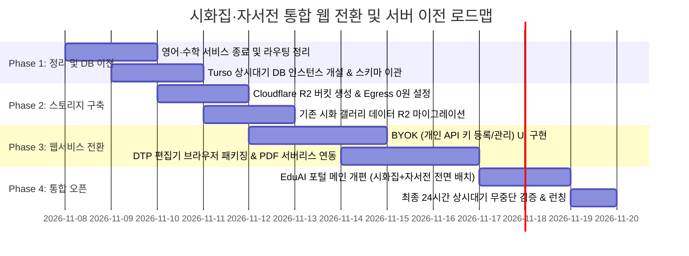

# 📘 시화집·자서전 통합 웹서비스 전환 및 무중단 서버 이전 마스터 플랜

> **문서 버전**: v1.0.0  
> **수립 일자**: 2026년 11월 7일  
> **작성자**: 안실장 (Creative Companion & System Architect)  
> **핵심 목표**: 영어·수학 서비스 종료 및 **「시화집(StoryBook)」 + 「자서전(TogetherStory)」 2대 감성 라이프스토리 라인업 집중**, **Supabase 수면 문제 영구 퇴출**, **운영비 0원(Free Tier) 상시대기 웹서비스 전환**

---

## Ⅰ. 전략적 서비스 라인업 개편 개요

```
[ 기존 4대 포트폴리오 ]                    [ 개편 후 2대 집중 포트폴리오 ]
- 🧮 EduAI_Math (수학)       ──(종료)──>  
- 🗣️ EduAI_FL_V2 (외국어)   ──(종료)──>  
- 📖 TogetherStory (자서전) ───────────>  🏛️ 1. 온 세대 기억 자서전 (TogetherStory)
- 🎨 StoryBook (시화집)      ───────────>  🎨 2. 감성 시화집 스튜디오 (StoryBook Studio)
```

1. **선택과 집중**: 유지보수 부담이 크고 수면 문제에 취약했던 주니어 학습(수학/영어) 서비스를 정리하고, 진정성과 시장 확장성이 높은 **시니어·성인 대상 감성 라이프스토리(시화집 + 자서전)**에 전사 역량을 집중합니다.
2. **배포 형태 전환**: 진입장벽이 높았던 **로컬 PC 다운로드형(설치형)**을 전격 폐지하고, 누구나 URL 링크 하나로 모바일·태블릿·PC에서 즉시 접속하는 **초경량 웹서비스(Web SaaS)**로 전환합니다.
3. **무과금 상시대기 인프라**: 사용자가 뜸해도 절대 잠들지 않는(No Sleep) 최신 서버리스 스택을 결합하여 **고정 서버 운영비 0원**을 달성합니다.

---

## Ⅱ. 인프라 아키텍처 및 서버별 담당 역할

```mermaid
flowchart TD
    User["🧑 사용자 (스마트폰 / 태블릿 / PC 브라우저)"]

    subgraph CDN_Front["1. 웹 호스팅 & CDN (Cloudflare Pages)"]
        UI_Studio["🎨 시화집 DTP 스튜디오 웹 UI"]
        UI_Story["📖 자서전 인터뷰 & 집필 웹 UI"]
        UI_Gallery["🖼️ 온라인 감성 시화 갤러리"]
    end

    subgraph Edge_DB["2. 데이터베이스 (Turso libSQL) - 상시대기 No Sleep"]
        DB_User["회원 계정 & 인증"]
        DB_Poem["시/수필 텍스트 & 메타데이터"]
        DB_Bio["자서전 구술 녹취록 & 챕터"]
    end

    subgraph Object_Storage["3. 대용량 미디어 스토리지 (Cloudflare R2) - 트래픽 0원"]
        R2_Image["시화 고화질 그림 (WebP/PNG)"]
        R2_Audio["시 낭송 MP3 & 구술 육성 음성"]
        R2_PDF["부크크(Bookk) 300DPI 인쇄용 PDF"]
    end

    subgraph Backend_Engine["4. 서버리스 연산 엔진 (Vercel / Render / Cloudflare Workers)"]
        PDF_Engine["ReportLab 벡터 PDF 생성기"]
        Voice_Engine["Gemini TTS 낭송 스크립트 전처리"]
    end

    subgraph Client_AI["5. AI 추론 레이어 (BYOK - 사용자 개별 API 키)"]
        Gemini_Client["Google Gemini API (시 창작 / 그림 생성 / 인터뷰)"]
    end

    User --> CDN_Front
    User -.->|개인 API 키 직접 호출 (서버비용 0원)| Gemini_Client
    CDN_Front --> Edge_DB
    CDN_Front --> Object_Storage
    CDN_Front --> Backend_Engine
    Backend_Engine --> Object_Storage
```

### 각 서버별 세부 역할 정의

| 서버 / 플랫폼 | 담당 역할 및 데이터 | 과금 방식 및 무료 혜택 | 핵심 선정 사유 |
| :--- | :--- | :--- | :--- |
| **🌐 Cloudflare Pages** | • 시화집 스튜디오 웹 UI<br>• 자서전 작성 웹 UI<br>• 온라인 갤러리 배포 | **완전 무료**<br>(대역폭 무제한, 요청 수 무제한) | 전 세계 300개 엣지 캐시로 접속 속도 최고, 동시접속 수만 명도 다운되지 않음. |
| **🗄️ Turso (libSQL)** | • 사용자 회원 장부<br>• 시 원고 및 자서전 본문 텍스트<br>• 갤러리 작품 목록 및 좋아요/댓글 | **완전 무료**<br>(DB 500개 무료, 9GB 용량, 월 10억 회 읽기) | **절대 잠들지 않음(No Sleep).** Supabase의 7일 강제 수면 문제 완벽 퇴출. |
| **📦 Cloudflare R2** | • 화가 AI가 그린 고화질 원본 삽화<br>• 시 낭송 MP3 & 인터뷰 육성 파일<br>• 부크크 인쇄용 완성 PDF | **월 10GB 무료**<br>(단일 파일 최대 5TB, **다운로드 트래픽 평생 0원**) | AWS S3와 달리 다운로드 요금(Egress)이 0원이라 갤러리 방문자가 폭증해도 비용 0원. |
| **⚙️ 서버리스 백엔드** | • 부크크(Bookk) A5 벡터 PDF 조판<br>• 이미지 여백/마스킹 후처리 | **무료 티어 내 가동**<br>(Vercel Serverless / Fly.io) | 사용자가 [PDF 다운로드]를 누를 때만 마이크로초 단위로 기동하여 자원 낭비 제로. |
| **🔑 브라우저 로컬 (BYOK)** | • 사용자의 Google Gemini API 키 보관<br>• 시 창작/퇴고 및 화풍 프롬프트 호출 | **0원 (사용자 자원 활용)**<br>서버 API 비용 부담 0% | 서비스 제공자(대표님)에게 API 비용 폭탄이 청구되는 원인을 원천 차단. |

---

## Ⅲ. 시화집 앱 웹서비스 전환 실행 계획

### 1. 사용자 개별 API 키(BYOK: Bring Your Own Key) 등록 시스템

웹서비스 전환 시 서비스 제공자의 최대 리스크는 **사용자들의 AI 생성 호출로 인한 API 요금 폭탄**입니다. 이를 해결하기 위해 글로벌 AI 툴들의 표준인 **BYOK 시스템**을 도입합니다.

```
[사용자 브라우저 설정]
   ┌──────────────────────────────────────────────┐
   │ ⚙️ AI 창작 스튜디오 설정                       │
   │                                              │
   │ Google Gemini API Key:                       │
   │ [ AIzaSyD************************* ] [저장]  │
   │ ℹ️ API 키는 서버로 전송되지 않고 본인         │
   │    브라우저의 암호화 저장소에만 안전 보관됩니다. │
   │ 🔗 [무료 Gemini API Key 발급받기 (1분 소요)]  │
   └──────────────────────────────────────────────┘
```

1. **보안성(Security)**:
   - 사용자가 입력한 API 키는 백엔드 서버 DB에 저장하지 않고, 사용자 브라우저의 `localStorage`에 암호화 보관됩니다.
   - 키 유출 위험 및 서버 해킹 위협을 100% 원천 차단합니다.
2. **비용 0원화**:
   - 시 짓기, 퇴고, 수묵화/유화/수채화 이미지 생성 시 사용자의 API 키가 Google 엔드포인트를 직접 호출합니다.
   - 대표님께 청구되는 AI 비용은 **완벽히 0원**입니다.
3. **편의성 (원클릭 가이드)**:
   - "Google AI Studio에서 무료 키 발급받는 법"을 스크린샷 3장 팝업으로 안내하여 어르신이나 초보자도 1분 만에 등록하도록 유도합니다.

---

### 2. DTP 편집기 클라이언트 웹 완결화

현재 `d:\AG\StoryBook`의 로컬 웹 엔진(`dtp_editor_core.js`, `index.html`)을 순수 브라우저 독립 실행형으로 패키징합니다.

* **상·하 2단 분할 본문 상자**: 브라우저 렌더링 엔진에서 드래그/리사이즈/폰트 변경 실시간 처리.
* **그림틀 형태 마스킹 (Shape Masking)**:
  - 사각, 원형(달맞이 창), 육각(전통 꽃살문), 아치형 마스킹을 브라우저 Canvas 및 CSS 마스킹으로 즉각 미리보기 제공.
* **외곽 10% 페이드아웃 (Soft Vignette)**:
  - 캔버스 레이어에서 실시간 그라데이션 합성 처리.

---

### 3. 부크크(Bookk) 인쇄용 PDF 비동기 생성 파이프라인

1. 사용자가 웹 편집기에서 `[📖 부크크 출판용 PDF 다운로드]` 클릭.
2. 프론트엔드가 페이지 레이아웃 메타데이터(JSON)와 R2 이미지 URL을 서버리스 백엔드로 전송.
3. 백엔드(`bookk_pdf_builder.py`)가 ReportLab으로 300 DPI 내지/표지 벡터 PDF를 2~3초 만에 생성.
4. 생성된 PDF를 Cloudflare R2에 임시 적재 후, 사용자 브라우저로 직통 다운로드 링크 반환.
5. **용량 관리 정책**: 생성된 인쇄용 PDF는 7일 후 R2 생명주기 규칙(Lifecycle Rule)에 의해 자동 삭제되어 10GB 무료 용량을 영구 보존.

---

## Ⅳ. 단계별 이전 로드맵 및 실행 스케줄



### [Phase 1] 구 서비스 정리 및 Turso DB 이전 (1~2일차)
- `EduAI_Hub` 포털 메뉴에서 `EduAI_Math`, `EduAI_FL_V2` 링크 제거 및 아카이빙 처리.
- 잠자는 Supabase 연동 코드를 완전히 걷어내고, Turso 상시대기 DB로 `TogetherStory` 및 `StoryBook` 통합 유저/원고 스키마 이전.

### [Phase 2] Cloudflare R2 미디어 파이프라인 구축 (3~4일차)
- Cloudflare R2에 `storybook-media` 버킷 생성 (무료 10GB, 다운로드 무제한 0원).
- 고화질 그림, 낭송 오디오, PDF 업로드/다운로드 API 연동.

### [Phase 3] 시화집 스튜디오 웹 SaaS 패키징 (5~7일차)
- 사용자가 자신의 Gemini API Key를 등록하여 사용하는 **BYOK 모달** 탑재.
- 브라우저 DTP 편집기(`index.html`)와 Python PDF 조판 엔진(`bookk_pdf_builder.py`)의 서버리스 연동.

### [Phase 4] 포털 통합 및 공식 오픈 (8~9일차)
- EduAI 공식 도메인(`eduai.kr` 등)을 Cloudflare Pages에 연결.
- 메인 화면에 **[1. 온 세대 기억 자서전]**과 **[2. 감성 시화집 스튜디오 & 온라인 갤러리]**를 나란히 배치하여 24시간 365일 무중단 서비스 개시.

---

## Ⅴ. 기대 효과 및 최종 산출물

1. **서버 운영비 0원 실현**:
   - Cloudflare Pages(웹 무제한 0원) + Cloudflare R2(10GB 무료, 트래픽 0원) + Turso(상시대기 500개 DB 0원) + BYOK(AI 비용 0원) 구조로 **월 고정비 0원**.
2. **서비스 안정성 100% 확보**:
   - 7일마다 잠들던 Supabase 고통에서 완전히 벗어나, 1년 뒤에 방문해도 0.1초 만에 사이트와 갤러리가 즉시 열림.
3. **고객 접근성 극대화**:
   - PC 다운로드/설치라는 큰 장벽이 사라져, 스마트폰 카카오톡 링크로 지인들에게 내 시화집을 보여주고 주문 인쇄까지 연결 가능.

