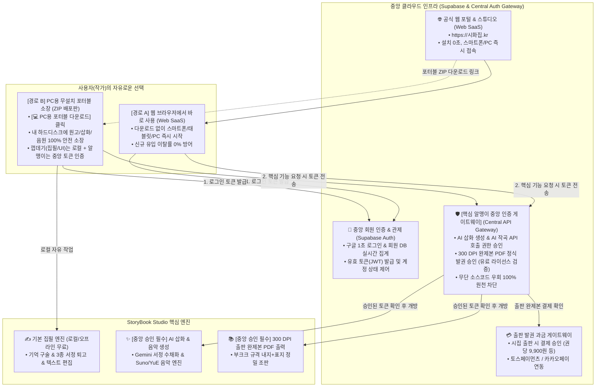

# 🚀 StoryBook Studio & 온라인 시화 갤러리 종합 배포 계획서 (최종 개정판)

> **"가장 개인적인 기억이 가장 깊은 문학이자 예술이 된다."**  
> 본 계획서는 기억 기반 시화집 독립출판 엔진 **StoryBook Studio**를 일반 대중(시인, 작가, 비개발자)에게 성공적으로 서비스하기 위한 **Web-First(웹서버 즉시 접속) + PC용 무설치 포터블(ZIP 다운로드) 듀얼 배포 전략**, **중앙 회원 로그인 및 실시간 관제 체계**, **부크크(Bookk) 300 DPI 정밀 출판 연동**, 그리고 **향후 완제본 PDF 출력 시점의 과금(Freemium) 수익화 로드맵**을 정의합니다.

---

## 1. 핵심 아키텍처 철학: [Web-First SaaS] + [Desktop Portable Choice]

전 세계 최고의 생산성 도구들(Notion, Figma, Obsidian 등)이 채택하는 **"웹에서 바로 쓰는 간편함 + 내 PC에 소장해 쓰는 안정성"**의 듀얼 배포 아키텍처를 확립합니다.



---

## 2. 듀얼 배포 및 운영 세부 전략

### 🌐 Strategy 1: Web-First 배포 (대중적 접근성 극대화)

카카오톡, 블로그, SNS를 통해 유입된 비개발자/일반인이 아무런 설치 장벽 없이 즉시 시를 쓰고 시화집을 만들 수 있는 주력 채널입니다.

1. **접속 방식**: 웹 브라우저(Chrome, Safari, Edge 등)로 `https://시화집.kr` 접속 ➔ **설치 허들 0%**.
2. **반응형 지원**: PC, 맥, 아이패드, 스마트폰 어디서나 최적화된 서정 UI 제공.
3. **구글 1초 로그인**: 복잡한 회원가입 양식 없이 구글 계정 클릭 한 번으로 가입/로그인 완료.
4. **포터블 다운로드 배너 상시 제공**:  
   * 웹사이트 상단 헤더에 **`[💻 PC용 무설치 포터블 버전 받기 (ZIP)]`** 버튼을 상시 노출하여, 원하는 작가가 언제든 로컬 소장형으로 전환할 수 있도록 안내.

---

### 💻 Strategy 2: PC용 무설치 포터블(ZIP) 배포 (소장형 진성 작가 지원)

인터넷 속도나 서버 안정성과 무관하게, 본인 PC에서 조용히 장기간 시집을 집필하고 대용량 인쇄 작업을 수행하려는 전문 작가와 어르신들을 위한 옵션입니다.

1. **배포 형태**: `StoryBook_Studio_v1.0.zip` (단일 압축 파일)
2. **사용자 경험**:
   * 압축을 풀고 **`[시집만들기.bat]`** 더블클릭 ➔ 1초 만에 브라우저 풀스크린 자동 실행.
   * 레지스트리 및 시스템 폴더를 건드리지 않아 **Windows SmartScreen 경고 및 백신 오탐 원천 차단**.
3. **초경량 내장 런타임**:
   * 사용자 PC에 파이썬이 설치되어 있지 않아도 완벽하게 독립 실행.
4. **저작권 100% 로컬 보관**:
   * 미발표 원고, 300 DPI 원본 수채화 이미지, 배경음악 MP3가 작가 본인의 하드디스크(`projects/`)에 무손실로 안전하게 보관됨.
5. **🛡️ [핵심 보안] 알맹이 기능의 중앙 서버 토큰 인증 체계 (소스코드 우회 원천 차단)**:
   * **원리**: 포터블 ZIP 배포판의 파이썬 소스코드를 개발자가 임의로 수정하거나 로그인 검사 코드를 우회하더라도, **핵심 고부가가치 알맹이 기능은 중앙 서버의 승인 없이는 작동하지 못하도록 설계**합니다.
   * **기능별 2원화 통제**:
     * **[로컬 껍데기 영역 (오프라인 무료)]**: UI 표시, 시 텍스트 타이핑, 기억 인터뷰 구술 기록, 내 PC 파일 저장 등 기본 집필실 기능은 로컬에서 가볍고 안전하게 구동.
     * **[중앙 서버 승인 영역 (핵심 알맹이 통제)]**:
       * **① AI 서정 삽화 & 감성 노래 생성**: 생성 요청 시 중앙 서버에서 발급한 **유효 로그인 토큰(JWT)**을 필수 검증하여, 정상 로그인 회원에게만 API 게이트웨이를 개방.
       * **② 부크크 300 DPI 출판 완제본 PDF 정식 출력**: 최종 인쇄용 고해상도 완제본(내지+표지) 빌드 시 중앙 서버에 로그인 상태와 **출판 라이선스(결제 승인 토큰)**를 조회하여, 서버의 암호화 승인이 있을 때만 완제본 출력을 실행.
   * **보안 결론**: 사용자가 로컬 파이썬 코드를 아무리 뜯어고쳐도, **알맹이 기능의 열쇠(중앙 토큰)는 우리 서버가 쥐고 있으므로 불법 무단 복제 및 라이선스 우회가 100% 원천 차단**됩니다.

---

### 👥 Strategy 3: 중앙 회원 인증 및 실시간 관제 체계

웹 사용자이든 포터블 사용자이든, **동일한 중앙 인증(Supabase + Google OAuth)**을 통해 일원화된 관제가 이루어집니다.

1. **누가, 몇 명이 사용하는가? (대표님 실시간 모니터링)**:
   * **Supabase 중앙 콘솔**: 등록된 전체 회원 수(MAU), 신규 가입자 이메일, 성명, 최근 로그인 일시를 실시간 확인.
   * **최고 관리자 관제 센터 (`/admin`)**:
     * 전체 시화집 프로젝트 수 및 누적 집필 편수.
     * 생성된 300 DPI 출판용 삽화 총 수량.
     * 회원별 집필 진척도 및 활동 현황 한눈에 파악.
2. **라이선스 및 보안 제어**:
   * 특정 악성 사용자나 비인가 사용자가 발생할 경우, 대표님이 중앙에서 **[계정 차단(Disable)]** 클릭 시 웹과 로컬 포터블 양쪽 모두에서 즉시 이용 정지.
3. **운영비 0원 구조**:
   * Supabase 무료 티어(월 활성 사용자 50,000명까지 평생 무료)를 활용하여 대규모 사용자가 몰려도 고정 서버비 부담 없음.

---

### 💰 Strategy 4: 향후 출판 완제본 PDF 출력 시점 과금 (Freemium 수익화)

창작의 즐거움은 무료로 활짝 열어두고, 실질적인 결실인 **종이책 출판 완제본(300 DPI 내지 + 표지)을 내려받는 결정적 순간에 과금**하는 가장 이상적인 수익화 모델입니다.

```
[ 창작 및 감상 단계 ] ──────── 100% 무료 개방 (Free)
  • 기억 인터뷰 구술 & 시 창작 & 3종 서정 퇴고
  • 한국적 서정 수채화 삽화 & 감성 노래 음원 생성
  • 웹 화면 2P/4P 실제 조판 감리 및 시 낭송(TTS) 듣기

[ 출판 결실 단계 ] ─────────── 유료 라이선스 발권 (Paid)
  • [📚 부크크 300 DPI 완제본 내지 + 표지 PDF 다운로드] 클릭 시 결제 팝업
  • 결제 옵션:
    ① 시집 1권 공식 출판 완제본 패키지 발권권: 9,900원 (건당 결제)
    ② 1년 무제한 출판 작가 패스: 39,000원 (구독형)
  • 토스페이먼츠 / 카카오페이 원클릭 간편결제 연동
```

* **수익화 갱신 및 우회 차단**:
  * 스튜디오의 PDF 다운로드 API에 중앙 라이선스 검증 데코레이터(`verify_paid_license(token)`)를 탑재.
  * 로컬 PC에서 임의로 버튼을 누르더라도 중앙 서버가 발급한 **유효 결제 서명(Token)**이 대조되지 않으면 고해상도 PDF 렌더링 파이프라인 자체가 열리지 않으므로 수익 누수를 100% 방지.
* **압도적 결제 전환율**: 이미 몇 주간 정성을 쏟아 책을 완성한 작가는 9,900원의 출판 발권료에 거부감 없이 기쁜 마음으로 결제함.

---

### 📚 Strategy 5: 부크크(Bookk) POD 인쇄 규격 완벽 대응

Canva 없이도 StoryBook Studio 자체만으로 표지부터 판권지까지 100% 완결 출판할 수 있도록 정밀 조판 엔진이 구축되어 있습니다.

1. **국판 A5 (148 × 210 mm) 1순위 표준 추천**:
   * 일반 단행본 베스트셀러 규격으로, 그림과 글씨가 시원시원하여 어르신 및 독자 시각 만족도 극대화.
2. **판형별 [내지 + 표지] 1:1 세트 다운로드 UI**:
   * **국판 A5 규격 세트**: `[📄 A5 내지 받기]` + `[🎨 A5 표지 받기]`
   * **사륙판 규격 세트**: `[📄 사륙판 내지 받기]` + `[🎨 사륙판 표지 받기]`
   * ➔ 내지와 표지가 한 쌍으로 묶여 있어 판형 엇갈림 사고 100% 방지.
3. **책등(세네카) 3대 정식 출판 정보 100% 인쇄**:
   * 2.0mm 이상 얇은 책등에서도 **[시집 제목(볼드) + 지은이 + 출판사명]**이 한국 정통 단행본 양식으로 단정하게 인쇄됨.
4. **본문 외 5대 출판 필수 요소 완결 편집실**:
   * 1. 서문(시인의 말) / 2. 맺음말(에필로그) / 3. 뒷표지 감성 추천 카피 / 4. 앞표지 삽화 및 정식 판권지 / 5. 시집 차례(목차 순서 및 부 구성).

---

## 3. 인프라 역할 분담: EduAI 생태계 vs StoryBook 시화집

기존에 운영 중이신 `EduAI` 시리즈와 이번 `StoryBook`의 인프라 역할 분담입니다.

| 프로젝트 | 기술 스택 | 배포 인프라 | 선정 이유 |
| :--- | :--- | :--- | :--- |
| **EduAI_Hub** | Next.js 15, React 19 | **Vercel** (유지) | Next.js 풀스택 라우팅 및 교육 포털 최적화 |
| **EduAI_FL_V2 / Math** | Frontend + Python Backend | **Vercel** (유지) | 기존 CI/CD 및 교육용 API 안정성 유지 |
| **StoryBook 웹 스튜디오** | Python FastAPI, Jinja2, ReportLab | **Cloud Server / PaaS** | **Web-First 대중 유입**, 구글 로그인 즉시 사용 |
| **StoryBook 포터블 ZIP** | Embedded Python, PyMuPDF | **사용자 PC 로컬 (ZIP)** | 소장형 작가 지원, 대용량 파일 로컬 보관, 오프라인 독립 실행 |
| **StoryBook 시화 갤러리** | HTML5, WebP, MP3, 원본 PDF | **Cloudflare R2 / Pages** | **무제한 대역폭 무료 CDN**, 300 DPI 고화질 전송 비용 0원 |

---

## 4. 최종 개발 및 배포 실행 로드맵 현황

- [x] **배포 계획서 종합 개정 (Web-First SaaS + 포터블 ZIP 듀얼 배포 확정)**
- [x] **스튜디오 포터블 런타임 실행기 구축 (`시집만들기.bat`)**
- [x] **부크크(Bookk) 전용 300 DPI PDF 조판 엔진 완성 (`core/bookk_pdf_builder.py`)**
  - 국판 A5 / 사륙판 규격, 사방 3mm 도련, 20mm 제본 여백, 책등 3대 정보 인쇄 완료
- [x] **시집 본문 외 5대 출판 필수 요소 편집실 구축 (서문 · 맺음말 · 뒤표지 · 판권지 · 목차)**
- [x] **판형별 [내지 + 표지] 1:1 세트 다운로드 UI 탑재**
- [x] **Supabase 중앙 회원가입/구글 로그인 및 최고 관리자 센터(`/admin`) 연동**
- [x] **향후 PDF 다운로드 시점 과금(Freemium) 아키텍처 수립**
- [x] **핵심 알맹이 기능 중앙 토큰 인증 체계 (AI 생성 & 완제본 PDF 출력 소스코드 우회 원천 차단) 수립**
- [ ] **웹서버 배포(SaaS) 환경 구성 및 포터블 다운로드 링크 연결**
- [ ] **최종 배포용 포터블 패키지(`StoryBook_Studio_v1.0.zip`) 빌드**
